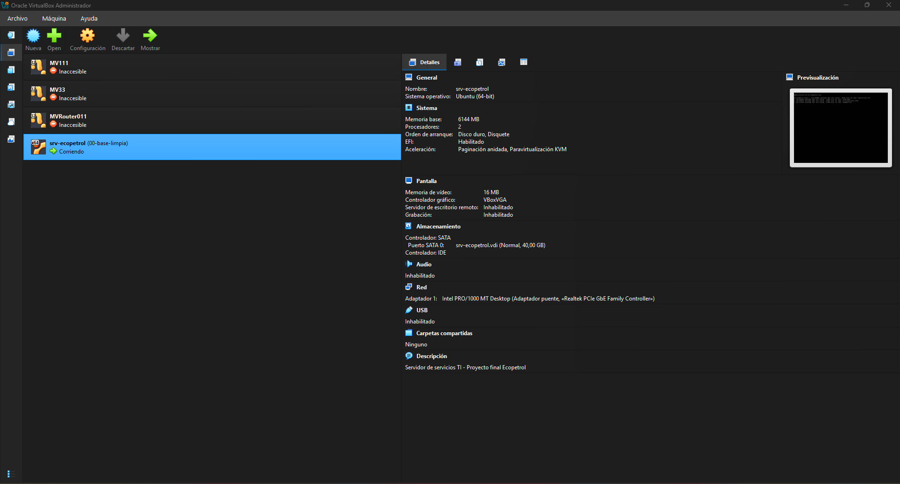
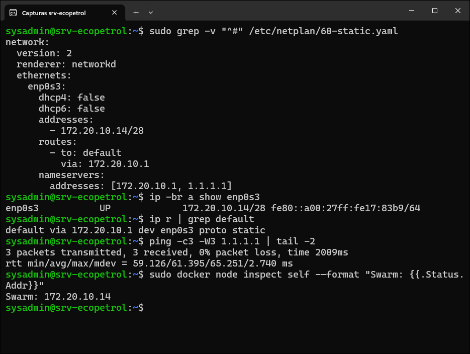
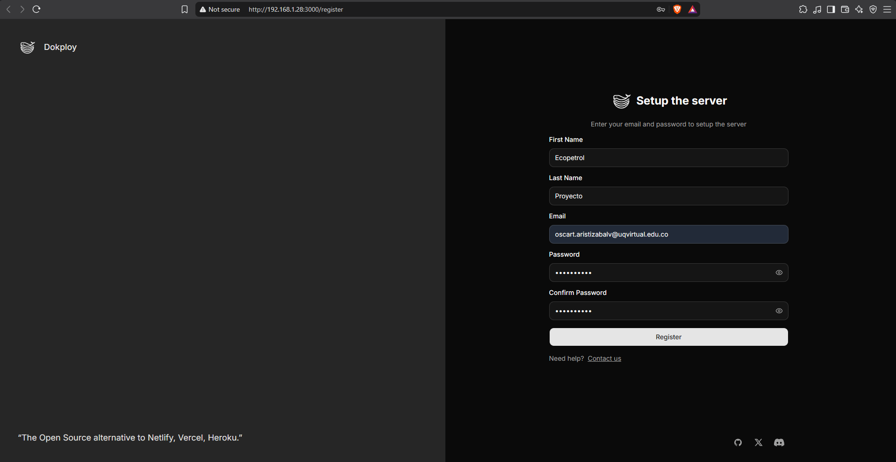
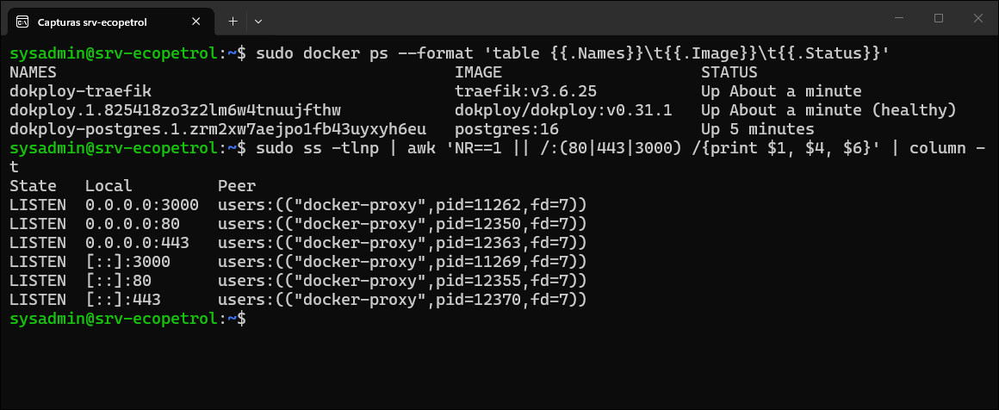
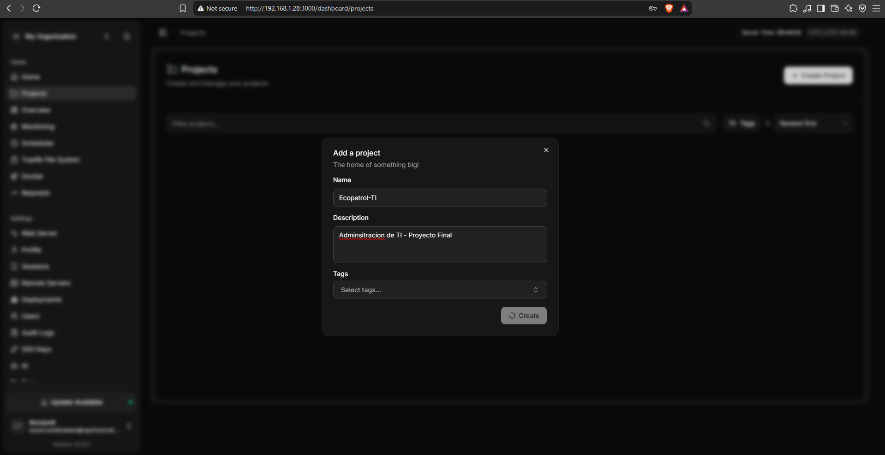
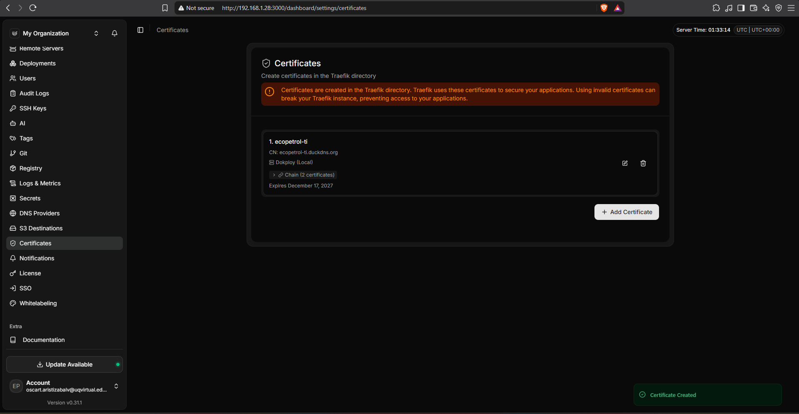
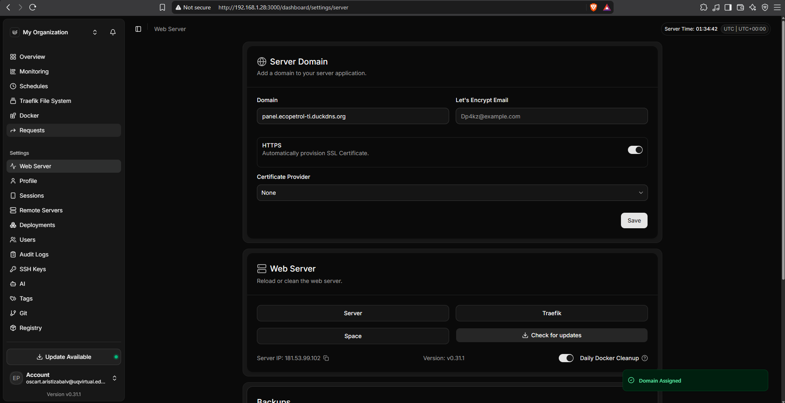
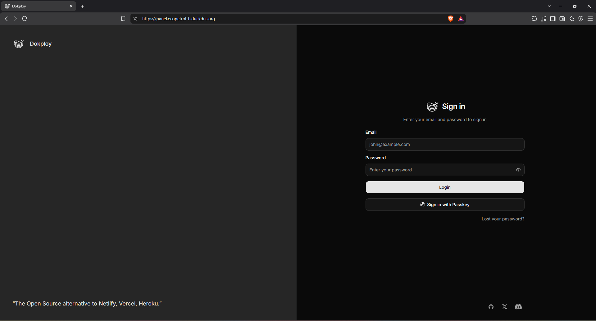

# Documentación técnica: infraestructura de TI para Ecopetrol (sede Bogotá)

> Proyecto final de Administración de Infraestructura de TI, Universidad del Quindío.
> Esqueleto con índice y plantilla por servicio. Cada responsable completa su sección y D consolida y revisa.

## Índice

0. Introducción y entorno
1. VM y red (A)
2. Dokploy (A)
3. DNS y HTTPS (A)
4. NTP (B)
5. Base de datos (B)
6. Web (B)
7. NIS (C)
8. NFS (C)
9. Samba (D)
10. CUPS (D)
11. Integración y pruebas cruzadas (A)
12. Extras
13. Problemas generales
14. Conclusiones

## Plantilla por servicio

Cada sección de servicio (4 a 10) usa esta estructura:

```
### Objetivo
### Instalación (comandos)
### Verificación (comando y salida esperada)
### Capturas
### Problemas encontrados (mínimo 2 reales: síntoma, causa, solución)
```

Reglas: capturas enlazadas con ruta relativa `` (GitHub distingue mayúsculas y minúsculas); sin contraseñas ni tokens visibles.

---

## 0. Introducción y entorno

_Pendiente (A y D): empresa (Ecopetrol), objetivo del proyecto, equipo, tabla de valores compartidos (IP, dominio, puertos, UID/GID), versiones de software._

## 1. VM y red (A)

### Objetivo
Un único servidor `srv-ecopetrol` que aloja todos los servicios: los web y los de red se despliegan con Dokploy y NIS/NFS en el host. Tiene IP fija y es alcanzable desde los clientes de la misma red.

### Instalación (comandos)

| Parámetro | Valor |
|---|---|
| Hipervisor | VirtualBox 7.2.6 sobre Windows 11, con AMD-V (Hyper-V desactivado en el anfitrión; ver *Problemas encontrados*) |
| SO | Ubuntu Server 24.04.5 LTS, kernel 6.8.0-149 |
| Firmware | **EFI** |
| CPU / RAM / Disco / Swap | 2 vCPU / 6 GB / 40 GB (VDI dinámico) / 2 GB |
| Gráficos | VBoxVGA |
| Red | Adaptador puente; IP fija `172.20.10.14/28`, gateway y DNS `172.20.10.1` (+ `1.1.1.1`) |
| Usuario del SO | `sysadmin` (UID 1000), sudo |

```bash
sudo bash codigo/servidor/preparar-servidor.sh   # actualización, swap 2 GB, TZ America/Bogota, NTP del host OFF
```
El NTP del host se desactiva porque el contenedor chrony (sección 4) es la única autoridad de hora; dos procesos ajustando el reloj se pelean.

IP fija con netplan (`codigo/servidor/netplan-60-static.yaml.example`), desactivando antes la red de cloud-init. El paso a paso completo está en `codigo/servidor/CHECKLIST.md`.

Snapshots (siempre con la VM apagada): `00-base-limpia` (SO preparado), `01-dokploy` (Dokploy con admin y proyecto) y `02-ntp-db` (NTP y base de datos desplegados).

### Verificación (comando y salida esperada)
```bash
free -h | grep Swap          # Swap: 2.0Gi
timedatectl                  # Time zone: America/Bogota, NTP service: inactive
ip -br a show enp0s3         # 172.20.10.14/28
```

### Capturas





### Problemas encontrados
| Síntoma | Causa | Solución |
|---|---|---|
| El instalador de Ubuntu 24.04 se quedaba colgado al arrancar | La VM estaba creada con firmware BIOS | Recrear la VM con **EFI** activado |
| Errores `vmwgfx` en la consola | Controlador gráfico VMSVGA | Cambiar a **VBoxVGA** |
| Al tomar un snapshot con la VM encendida, la VM se congeló y quedó *inaccessible* | VirtualBox corre sobre Hyper-V (NEM); el snapshot en caliente dejó un disco diferencial huérfano | Reparación manual del `.vbox` para volver a enlazar el disco. Regla: **snapshots solo con la VM apagada** |
| La VM arrancó sin IPv4 y no respondía por SSH | El adaptador puente estaba sobre el Wi-Fi, pero el anfitrión estaba conectado por cable | `VBoxManage controlvm srv-ecopetrol nic1 bridged "<adaptador Ethernet>"` y `sudo networkctl reconfigure enp0s3` |
| La VM tardaba ~7 min en arrancar, se congelaba 1-3 min por ratos y una vez 5 h seguidas (`soft lockup - CPU#1 stuck for 17940s!` en `journalctl -b`) | Windows tenía cargado el hipervisor de Hyper-V, así que VirtualBox no podía usar AMD-V directamente y corría en modo NEM (`VBox.log`: "NEM … Snail execution mode", "TM: Giving up catch-up"). El hipervisor lo forzaban la Integridad de memoria (VBS/HVCI), Windows Hello con inicio de sesión mejorado y la característica *Plataforma de máquina virtual* | Desactivar las cuatro cosas: `bcdedit /set hypervisorlaunchtype off`, `DeviceGuard\EnableVirtualizationBasedSecurity`=0, `Scenarios\HypervisorEnforcedCodeIntegrity\Enabled`=0, `Scenarios\WindowsHello\Enabled`=0 y `Disable-WindowsOptionalFeature VirtualMachinePlatform`; reiniciar. Comprobación: `(Get-CimInstance Win32_ComputerSystem).HypervisorPresent` = False y `VBox.log` dice "AMD-V w/ nested paging". Después: arranque y SSH en <1 min, 0 *soft lockups*. Costo: WSL2 y Docker Desktop no funcionan mientras esté así |
| Al pasar al hotspot la VM quedó sin red | El adaptador puente seguía sobre el Ethernet, que se había desconectado | `VBoxManage controlvm srv-ecopetrol nic1 bridged "<adaptador Wi-Fi>"` y `setlinkstate1 off/on` para que pidiera DHCP; luego netplan con IP fija |
| Después de fijar la IP, Swarm seguía anunciando la IP de casa (`docker node inspect self` → `192.168.1.28`) | Swarm guarda la `advertise-addr` con la que se inicializó | Respaldo de `/var/lib/docker/swarm` y `docker swarm init --force-new-cluster --advertise-addr 172.20.10.14`; los servicios y el heartbeat de 60 s se conservaron |
| SSH fallaba con `Host key verification failed` después de reconectar | El DHCP le dio otra IP a la VM (`.88` → `.28`) y esa IP no estaba en `known_hosts` | Comprobar que la huella ED25519 era la misma y agregarla con `ssh-keyscan`. La IP fija de la demo evita el problema |

## 2. Dokploy (A)

### Objetivo
PaaS autohospedado que despliega los servicios del equipo desde el repositorio de GitHub (Compose y Database), con Traefik como proxy inverso y terminación TLS.

### Instalación (comandos)
```bash
sudo ss -tulpn | grep -E ':(80|443|3000)\b'     # puertos libres
curl -sSL https://dokploy.com/install.sh | sudo sh
```
Versiones instaladas: Dokploy **v0.31.1**, Docker **28.5.0** (modo Swarm), Traefik **v3.6.25**, PostgreSQL **16** (base interna de Dokploy).

Después: crear el usuario administrador en `http://SERVER_IP:3000` y el proyecto **`Ecopetrol-TI`**.

### Verificación (comando y salida esperada)
```bash
sudo docker service ls     # dokploy 1/1, dokploy-postgres 1/1
sudo docker ps             # dokploy-traefik Up
curl -I http://localhost:3000   # 200 (o 307 a /register antes de crear el admin)
```

### Capturas






### Problemas encontrados
| Síntoma | Causa | Solución |
|---|---|---|
| Dokploy no podía clonar el repositorio | El repositorio era privado | Repositorio **público** (o conectar GitHub como proveedor en Dokploy) |
| Tras el cambio de IP de la VM, Swarm reinició dos veces `dokploy` y `dokploy-postgres` | Coincidió con el cambio de red; Swarm sigue anunciando la IP con la que se inicializó (`192.168.1.88`) | Los servicios se estabilizaron solos en ~1 min. Con la IP fija se volvió a anunciar el nodo con `--advertise-addr 172.20.10.14` (§1) |
| El panel se quedaba "cargando" para siempre y luego daba *Bad Gateway*; `journalctl -u docker` mostraba `node not registered` | Cada vez que la VM se congelaba (ver §1, Hyper-V), el nodo dejaba de enviar latidos al *dispatcher* de Swarm (5 s por defecto) y Swarm reiniciaba los servicios de Dokploy | Paliativo: `docker swarm update --dispatcher-heartbeat 60s`. No bastó con congelamientos de minutos u horas; el arreglo de fondo fue quitar Hyper-V del anfitrión (§1) |

## 3. DNS y HTTPS (A)

### Objetivo
Nombres estables para la web y el panel (`www.` y `panel.ecopetrol-ti.duckdns.org`) y HTTPS sin advertencias en los clientes.

### Instalación (comandos)

**DNS.** Subdominio `ecopetrol-ti` en DuckDNS apuntando a la IP privada del servidor. DuckDNS resuelve también cualquier subdominio (`www.`, `panel.`):
```bash
curl "https://www.duckdns.org/update?domains=ecopetrol-ti&token=<TOKEN>&ip=172.20.10.14&verbose=true"
```

**Certificado.** Dokploy solo emite Let's Encrypt con el reto HTTP, que necesita el puerto 80 alcanzable desde internet; una VM en red privada no lo es. Por eso se creó una **CA propia del laboratorio** y con ella el certificado del servidor:
```bash
bash codigo/servidor/generar-certificado.sh ecopetrol-ti.duckdns.org 172.20.10.14 ~/certs
```
- CA y servidor con ECDSA P-256; el servidor vale 397 días (máximo que aceptan los navegadores).
- SAN: `ecopetrol-ti.duckdns.org`, `*.ecopetrol-ti.duckdns.org`, `IP:172.20.10.14`.
- Las claves (`*.key`) no se suben al repositorio.

**En Dokploy:**
1. Settings → Certificates → Add Certificate: `fullchain.crt` (servidor + CA) y la clave en PKCS#8. Dokploy lo guarda en `/etc/dokploy/traefik/dynamic/certificates/<id>/` (`chain.crt`, `privkey.key`, `certificate.yml`).
2. Settings → Web Server → Server Domain: `panel.ecopetrol-ti.duckdns.org`, HTTPS on, Certificate Provider **None**. Traefik elige el certificado por SNI.

**En los clientes:** importar `ca.crt` como raíz de confianza (Windows: `certutil -addstore -f Root ca.crt`).

### Verificación (comando y salida esperada)
```bash
nslookup www.ecopetrol-ti.duckdns.org                                        # 172.20.10.14
curl -sSI --cacert ~/certs/ca.crt https://panel.ecopetrol-ti.duckdns.org     # HTTP/2 200, sin -k
echo | openssl s_client -connect panel.ecopetrol-ti.duckdns.org:443 \
  -servername panel.ecopetrol-ti.duckdns.org -CAfile ~/certs/ca.crt 2>/dev/null | grep 'Verify return code'   # 0 (ok)
```

### Capturas







### Problemas encontrados
| Síntoma | Causa | Solución |
|---|---|---|
| No se puede usar Let's Encrypt desde Dokploy | El reto HTTP necesita que el puerto 80 sea accesible desde internet; la VM está en red privada | CA propia + certificado con SAN de dominio, comodín e IP, cargado en Dokploy con proveedor **None** |
| No se pudo agregar la línea de prueba al archivo `hosts` de Windows (`Access denied`, luego `Stream was not readable`) | El archivo tiene atributo de solo lectura y estaba bloqueado por otro proceso | Para probar en casa se apuntó DuckDNS temporalmente a la IP de casa; con la IP fija se volvió a `172.20.10.14` (2026-11-18) y se validó otra vez el HTTPS sin `-k` |
| (Riesgo previsto) `nslookup` falla en algunas redes | Protección contra *DNS rebinding* del router: descarta respuestas con IP privada | El router de casa no la tiene. Si pasa en la demo: DNS `1.1.1.1` en el cliente o archivo `hosts` |

## 4. NTP (B)

### Objetivo
_Pendiente (B)._
### Instalación (comandos)
### Verificación (comando y salida esperada)
### Capturas
### Problemas encontrados

## 5. Base de datos (B)

### Objetivo
_Pendiente (B)._
### Instalación (comandos)
### Verificación (comando y salida esperada)
### Capturas
### Problemas encontrados

## 6. Web (B)

### Objetivo
_Pendiente (B)._
### Instalación (comandos)
### Verificación (comando y salida esperada)
### Capturas
### Problemas encontrados

## 7. NIS (C)

### Objetivo
_Pendiente (C)._
### Instalación (comandos)
### Verificación (comando y salida esperada)
### Capturas
### Problemas encontrados

## 8. NFS (C)

### Objetivo
_Pendiente (C)._
### Instalación (comandos)
### Verificación (comando y salida esperada)
### Capturas
### Problemas encontrados

## 9. Samba (D)

### Objetivo
Compartir la carpeta `administrativa` con clientes Windows, macOS y Linux, con autenticación por usuario, sin invitados y sin SMB1. Corre en un contenedor Alpine 3.20 (`codigo/samba/`), desplegado con Dokploy.

### Instalación (comandos)
```bash
cd codigo/samba
cp .env.example .env            # editar SMB_PASSWORD
docker compose up -d --build
docker compose logs -f samba
```
En Dokploy: servicio Compose, *Compose Path* `./codigo/samba/docker-compose.yml`, variables en la pestaña *Environment*.

### Verificación (comando y salida esperada)
```bash
bash codigo/samba/verify.sh server            # [OK] en las 4 comprobaciones, exit 0
bash codigo/samba/verify.sh client SERVER_IP   # con SMB_PASSWORD exportada
```
- `docker exec <samba> pdbedit -L` lista `fin.bogota`, `rrhh.bogota` y `admin.ti`.
- `smbclient //SERVER_IP/administrativa -U lab.icpet1 -c ls` → `NT_STATUS_LOGON_FAILURE` o `ACCESS_DENIED`.
- Windows: `net use Z: \\SERVER_IP\administrativa /user:ECOPETROL\fin.bogota *` y crear un archivo.

### Capturas
_Pendiente: `samba/01_build-local`, `02_testparm`, `03_pdbedit-usuarios`, `04_windows-explorador`, `05_net-use-Z`, `06_escribir-archivo`, `07_usuario-no-autorizado-denegado`, `08_mac-o-linux-smbclient`._

### Problemas encontrados
_Pendiente: completar con los problemas reales de las pruebas (mínimo 2). Candidatos a revisar: `bind failed on port 445`, error 1219 de Windows por credencial en caché, permisos al escribir._

## 10. CUPS (D)

### Objetivo
Publicar una impresora virtual PDF (`Ecopetrol-Bogota-PDF`) compartida por IPP, administrable solo por `lpadmin`, accesible desde la subred de la oficina. Corre en un contenedor Debian 12 (`codigo/cups/`), desplegado con Dokploy.

### Instalación (comandos)
```bash
cd codigo/cups
cp .env.example .env            # editar CUPS_ADMIN_PASSWORD y ALLOW_SUBNET
docker compose up -d --build
docker compose logs -f cups
```
En Dokploy: servicio Compose, *Compose Path* `./codigo/cups/docker-compose.yml`.

### Verificación (comando y salida esperada)
```bash
bash codigo/cups/verify.sh server             # scheduler is running, cola idle/enabled, :631 abierto
bash codigo/cups/verify.sh client SERVER_IP   # request id is Ecopetrol-Bogota-PDF-N
docker exec <cups> ls -l /var/spool/cups-pdf/ANONYMOUS   # aparece el PDF nuevo
```
- Administración web: `https://SERVER_IP:631/admin` con `admin.ti` (certificado autofirmado, se acepta la advertencia).
- Windows: agregar la impresora por `http://SERVER_IP:631/printers/Ecopetrol-Bogota-PDF` con *Microsoft PS Class Driver* e imprimir una página de prueba.

### Capturas
_Pendiente: `cups/01_web-admin`, `02_cola-compartida`, `03_windows-agregar-impresora`, `04_pagina-prueba`, `05_lpstat-cola`, `06_pdf-generado`._

### Problemas encontrados
_Pendiente: completar con los problemas reales de las pruebas (mínimo 2). Candidatos a revisar: `400 Bad Request` sin `ServerAlias *`, `403` por usar `@LOCAL`, cola en *stopped*, driver en Windows._

## 11. Integración y pruebas cruzadas (A)

Orden de despliegue y comandos en `codigo/servidor/CHECKLIST.md` §7. Estado al 2026-11-18 (servidor en `172.20.10.14`):

| Servicio | Despliegue | `verify.sh server` | Prueba de cliente | Captura |
|---|---|---|---|---|
| NTP | Dokploy (Compose) | 6/6 OK | Windows `w32tm /stripchart` responde; Linux `^*` _pendiente_ | `ntp/05_dokploy-verify-server.png` |
| Base de datos | Dokploy (Database) | — | _pendiente (desde la web)_ | `web/05_bd-dokploy.png` |
| Web | _pendiente_ | | | |
| NIS | _pendiente (C)_ | | | |
| NFS | _pendiente (C)_ | | | |
| Samba | _pendiente (D)_ | | | |
| CUPS | _pendiente (D)_ | | | |

## 12. Extras

- **Cortafuegos (A):** `codigo/servidor/ufw.sh`. UFW por sí solo no protege los puertos de los contenedores, porque Docker los publica en la cadena `FORWARD` antes de que UFW los vea. El script pone UFW con política *deny* para el anfitrión (SSH y los puertos de NIS/NFS) y filtra la cadena `DOCKER-USER` para que a los contenedores solo lleguen las subredes permitidas. Probado: desde una subred no permitida el panel (3000) y el HTTPS (443) dan *timeout* y el kernel registra `[DOCKER-USER BLOQUEADO]`; SSH y la salida a internet de los contenedores siguen funcionando, y las reglas sobreviven a un reinicio. Se activa al final, con todos los servicios desplegados (`CHECKLIST.md` §7b).
- _Pendiente: backup automático, monitoreo, Docker Compose multi-contenedor._

## 13. Problemas generales

- **Red de la demo:** se eligió el hotspot de un celular (subred `172.20.10.0/28`) para tener la misma red en casa y en la universidad, porque muchas redes Wi-Fi universitarias aíslan clientes o rechazan una segunda MAC en el adaptador puente. Ojo: es una **/28**, no una /24, y eso afecta `allow` de chrony, `exports` de NFS y los `Allow` de Samba/CUPS.
- **VirtualBox y Hyper-V no conviven bien:** en Windows 11 el hipervisor puede quedar activo aunque Hyper-V "no esté instalado" (Windows Home), por la Integridad de memoria, Windows Hello mejorado o WSL2. VirtualBox arranca igual, pero en modo NEM, lento e inestable. Hay que revisarlo antes de montar cualquier servidor en VirtualBox (detalle en §1).
- **Certificado propio:** cada cliente tiene que importar `ca.crt` una vez; Firefox usa su propio almacén.
- _Pendiente (C y D): UID/GID entre servicios._

## 14. Conclusiones

_Pendiente: resultados, lecciones aprendidas, análisis costo-beneficio._
