# Documentación técnica: infraestructura de TI para Ecopetrol (sede Bogotá)

> Proyecto final de Administración de Infraestructura de TI, Universidad del Quindío.
> Esqueleto con índice y plantilla por servicio. Cada responsable completa su sección y D consolida y revisa.

## Índice

0. Introducción y entorno
1. VM y red (A)
2. Dokploy (A)
3. DNS y HTTPS (A)
4. NTP (B)
5. Base de datos (B)
6. Web (B)
7. NIS (C)
8. NFS (C)
9. Samba (D)
10. CUPS (D)
11. Integración y pruebas cruzadas (A)
12. Extras
13. Problemas generales
14. Conclusiones

## Plantilla por servicio

Cada sección de servicio (4 a 10) usa esta estructura:

```
### Objetivo
### Instalación (comandos)
### Verificación (comando y salida esperada)
### Capturas
### Problemas encontrados (mínimo 2 reales: síntoma, causa, solución)
```

Reglas: capturas enlazadas con ruta relativa `` (GitHub distingue mayúsculas y minúsculas); sin contraseñas ni tokens visibles.

---

## 0. Introducción y entorno

### Empresa, objetivo y equipo

_Pendiente (D): empresa (Ecopetrol), objetivo del proyecto y equipo. La descripción de la empresa y la justificación de cada servicio están en `analisis.md` §1 y §2._

### Entorno

Un solo servidor, `srv-ecopetrol`, aloja todos los servicios. Los que usan HTTP o se pueden empaquetar en contenedores se despliegan con **Dokploy** desde este repositorio; NIS y NFS se instalan en el **host** con scripts, porque dependen del kernel (`nfsd`) y de RPC. Detalle de la VM en §1 y arquitectura en `diagrama.mmd`.

| Elemento | Valor |
|---|---|
| Servidor | VM `srv-ecopetrol` en VirtualBox 7.2.6 (EFI, AMD-V), 2 vCPU, 6 GB de RAM, 40 GB de disco, 2 GB de swap |
| Sistema operativo | Ubuntu Server 24.04.5 LTS, kernel 6.8.0-149 |
| Red de la demo | Hotspot de celular, subred **`172.20.10.0/28`** (no /24), gateway y DNS `172.20.10.1` |
| IP del servidor | **`172.20.10.14`** fija (netplan), adaptador puente |
| Dominio | **`ecopetrol-ti.duckdns.org`** (DuckDNS, apunta a la IP privada; cualquier subdominio resuelve igual) |
| Sitio web | `https://www.ecopetrol-ti.duckdns.org` |
| Panel de Dokploy | `https://panel.ecopetrol-ti.duckdns.org` (o `http://172.20.10.14:3000`) |
| Certificado | CA propia del laboratorio; los clientes importan `ca.crt` una vez (§3) |
| Acceso de administración | SSH con llave, usuario `sysadmin` |
| Dominio NIS / grupo de trabajo SMB | `ecopetrol.local` / `ECOPETROL` |
| Zona horaria | America/Bogota; la hora la sirve el contenedor chrony (§4), el NTP del host está desactivado |

Clientes de prueba:

| Cliente | IP | Uso |
|---|---|---|
| VM `cli-icpet` (Ubuntu Server 24.04.5, 1 vCPU, 2 GB, puente sobre el Wi-Fi) | `172.20.10.13` fija | NTP (chrony), NIS, NFS y pruebas Linux de Samba/CUPS |
| Equipo físico Windows 11 (anfitrión de las VM) | `172.20.10.2` (DHCP del hotspot) | Samba, CUPS, Web y hora con `w32tm` |

### Puertos

Todos en `172.20.10.14`. La tabla completa, con el componente de cada servicio, está en `analisis.md` §3.

| Puerto | Protocolo | Servicio | Despliegue |
|---|---|---|---|
| 22 | TCP | SSH (administración) | Host |
| 80, 443 | TCP (+443/UDP HTTP/3) | Traefik: Web y panel por dominio, TLS | Dokploy |
| 3000 | TCP | Panel de Dokploy (acceso directo) | Dokploy |
| 123 | UDP | NTP (chrony) | Dokploy (Compose) |
| 445 | TCP | Samba (SMB 2/3, sin NetBIOS) | Dokploy (Compose) |
| 631 | TCP | CUPS (IPP, administración web) | Dokploy (Compose) |
| 111, 834, 835 | TCP/UDP | NIS (rpcbind, ypserv, yppasswdd) | Host |
| 2049 | TCP | NFSv4 | Host |
| 5432 | TCP | PostgreSQL: **no se publica**, solo red interna `dokploy-network` | Dokploy (Database) |

Los servicios que filtran por red usan la misma subred: chrony (`ALLOW_SUBNET`), CUPS (`ALLOW_SUBNET`), NFS (`exports`) y el cortafuegos opcional (§12) deben quedar en `172.20.10.0/28`.

### Usuarios y grupos (UID/GID)

Los mismos nombres en todos los servicios. NIS y NFS comparten UID y GID; Samba crea sus cuentas en su contenedor con los mismos UID y GID; CUPS solo usa `admin.ti` dentro de su contenedor.

| Grupo (GID) | Uso | Usuarios (UID) |
|---|---|---|
| `ti` (3001) | Administración de la infraestructura | `admin.ti` (2001) |
| `icpet` (3002) | Laboratorios del Icpet (NFS) | `lab.icpet1` (2011), `lab.icpet2` (2012) |
| `administrativa` (3003) | Oficina de Bogotá (Samba) | `fin.bogota` (2021), `rrhh.bogota` (2022) |
| `lpadmin` (contenedor CUPS) | Administración de impresoras | `admin.ti` |

Las contraseñas no se guardan en el repositorio: van en las variables de entorno de Dokploy o en archivos `.env` locales (hay un `.env.example` por servicio).

### Versiones de software

| Componente | Versión | Origen |
|---|---|---|
| VirtualBox | 7.2.6 | Anfitrión Windows 11 |
| Ubuntu Server | 24.04.5 LTS (kernel 6.8.0-149) | VM |
| OpenSSH | 9.6p1 | Paquete de Ubuntu |
| Docker | 28.5.0 (modo Swarm) | Instalado por Dokploy |
| Dokploy | v0.31.1 | `dokploy/dokploy` |
| Traefik | v3.6.25 | Instalado por Dokploy |
| PostgreSQL | 16.16 (base del proyecto) · 16.15 (base interna de Dokploy) | Dokploy Database |
| chrony (NTP) | 4.5 | Imagen `alpine:3.20` (servidor) · paquete de Ubuntu 4.5 (cliente) |
| Nginx (Web) | 1.27 | Imagen `nginx:1.27-alpine` |
| Node.js (API) | 20 | Imagen `node:20-alpine` |
| Samba | serie 4.19 | Imagen `alpine:3.20` (versión exacta al desplegar: `smbd --version`) |
| CUPS | 2.4 | Imagen `debian:12-slim` (versión exacta al desplegar: `cupsd -v`) |
| NIS / NFS | _pendiente (C)_ | Paquetes de Ubuntu 24.04 |

## 1. VM y red (A)

### Objetivo
Un único servidor `srv-ecopetrol` que aloja todos los servicios: los web y los de red se despliegan con Dokploy y NIS/NFS en el host. Tiene IP fija y es alcanzable desde los clientes de la misma red.

### Instalación (comandos)

| Parámetro | Valor |
|---|---|
| Hipervisor | VirtualBox 7.2.6 sobre Windows 11, con AMD-V (Hyper-V desactivado en el anfitrión; ver *Problemas encontrados*) |
| SO | Ubuntu Server 24.04.5 LTS, kernel 6.8.0-149 |
| Firmware | **EFI** |
| CPU / RAM / Disco / Swap | 2 vCPU / 6 GB / 40 GB (VDI dinámico) / 2 GB |
| Gráficos | VBoxVGA |
| Red | Adaptador puente; IP fija `172.20.10.14/28`, gateway y DNS `172.20.10.1` (+ `1.1.1.1`) |
| Usuario del SO | `sysadmin` (UID 1000), sudo |

```bash
sudo bash codigo/servidor/preparar-servidor.sh   # actualización, swap 2 GB, TZ America/Bogota, NTP del host OFF
```
El NTP del host se desactiva porque el contenedor chrony (sección 4) es la única autoridad de hora; dos procesos ajustando el reloj se pelean.

IP fija con netplan (`codigo/servidor/netplan-60-static.yaml.example`), desactivando antes la red de cloud-init. El paso a paso completo está en `codigo/servidor/CHECKLIST.md`.

Snapshots (siempre con la VM apagada): `00-base-limpia` (SO preparado), `01-dokploy` (Dokploy con admin y proyecto) y `02-ntp-db` (NTP y base de datos desplegados).

### Verificación (comando y salida esperada)
```bash
free -h | grep Swap          # Swap: 2.0Gi
timedatectl                  # Time zone: America/Bogota, NTP service: inactive
ip -br a show enp0s3         # 172.20.10.14/28
```

### Capturas
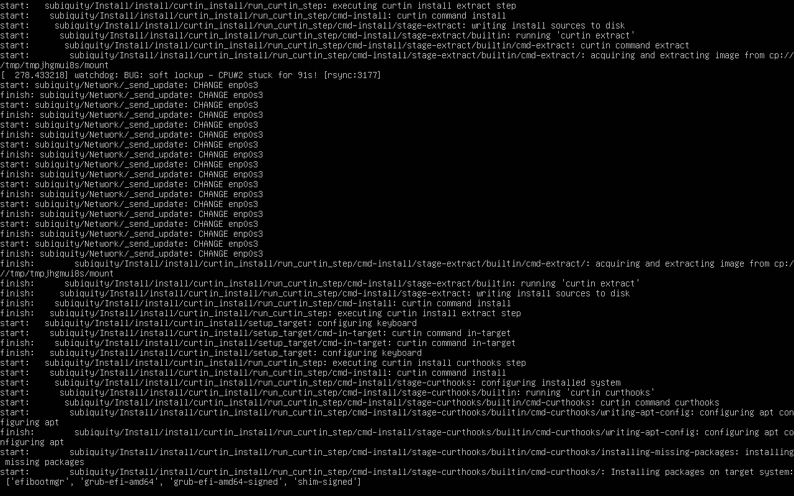

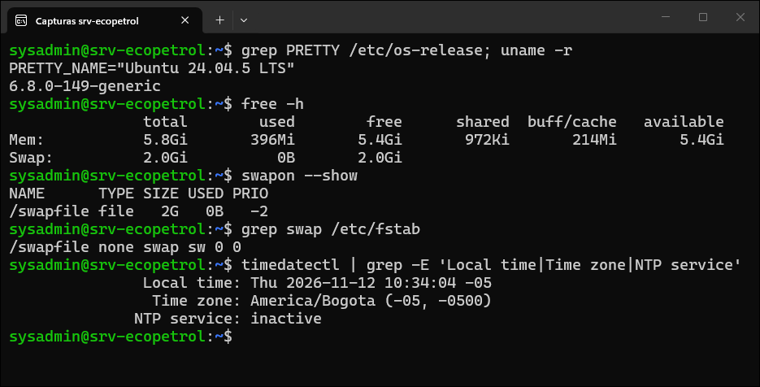


### Problemas encontrados
| Síntoma | Causa | Solución |
|---|---|---|
| El instalador de Ubuntu 24.04 se quedaba colgado al arrancar | La VM estaba creada con firmware BIOS | Recrear la VM con **EFI** activado |
| Errores `vmwgfx` en la consola | Controlador gráfico VMSVGA | Cambiar a **VBoxVGA** |
| Al tomar un snapshot con la VM encendida, la VM se congeló y quedó *inaccessible* | VirtualBox corre sobre Hyper-V (NEM); el snapshot en caliente dejó un disco diferencial huérfano | Reparación manual del `.vbox` para volver a enlazar el disco. Regla: **snapshots solo con la VM apagada** |
| La VM arrancó sin IPv4 y no respondía por SSH | El adaptador puente estaba sobre el Wi-Fi, pero el anfitrión estaba conectado por cable | `VBoxManage controlvm srv-ecopetrol nic1 bridged "<adaptador Ethernet>"` y `sudo networkctl reconfigure enp0s3` |
| La VM tardaba ~7 min en arrancar, se congelaba 1-3 min por ratos y una vez 5 h seguidas (`soft lockup - CPU#1 stuck for 17940s!` en `journalctl -b`) | Windows tenía cargado el hipervisor de Hyper-V, así que VirtualBox no podía usar AMD-V directamente y corría en modo NEM (`VBox.log`: "NEM … Snail execution mode", "TM: Giving up catch-up"). El hipervisor lo forzaban la Integridad de memoria (VBS/HVCI), Windows Hello con inicio de sesión mejorado y la característica *Plataforma de máquina virtual* | Desactivar las cuatro cosas: `bcdedit /set hypervisorlaunchtype off`, `DeviceGuard\EnableVirtualizationBasedSecurity`=0, `Scenarios\HypervisorEnforcedCodeIntegrity\Enabled`=0, `Scenarios\WindowsHello\Enabled`=0 y `Disable-WindowsOptionalFeature VirtualMachinePlatform`; reiniciar. Comprobación: `(Get-CimInstance Win32_ComputerSystem).HypervisorPresent` = False y `VBox.log` dice "AMD-V w/ nested paging". Después: arranque y SSH en <1 min, 0 *soft lockups*. Costo: WSL2 y Docker Desktop no funcionan mientras esté así |
| Al pasar al hotspot la VM quedó sin red | El adaptador puente seguía sobre el Ethernet, que se había desconectado | `VBoxManage controlvm srv-ecopetrol nic1 bridged "<adaptador Wi-Fi>"` y `setlinkstate1 off/on` para que pidiera DHCP; luego netplan con IP fija |
| Después de fijar la IP, Swarm seguía anunciando la IP de casa (`docker node inspect self` → `192.168.1.28`) | Swarm guarda la `advertise-addr` con la que se inicializó | Respaldo de `/var/lib/docker/swarm` y `docker swarm init --force-new-cluster --advertise-addr 172.20.10.14`; los servicios y el heartbeat de 60 s se conservaron |
| La VM cliente `cli-icpet` arrancó sin red: `enp0s3` en estado `DOWN` y `/etc/netplan/` vacío | Se instaló con el cable virtual desconectado (para no gastar datos móviles en actualizaciones); el instalador no vio red y no escribió ninguna configuración | Desde la consola, `sudo ip link set enp0s3 up` y `sudo dhcpcd enp0s3` para tener red temporal; luego, por SSH, netplan con IP fija `172.20.10.13/28` |
| SSH fallaba con `Host key verification failed` después de reconectar | El DHCP le dio otra IP a la VM (`.88` → `.28`) y esa IP no estaba en `known_hosts` | Comprobar que la huella ED25519 era la misma y agregarla con `ssh-keyscan`. La IP fija de la demo evita el problema |

### Cliente de pruebas Linux (`cli-icpet`)

VM aparte para probar los servicios desde un cliente real: Ubuntu Server 24.04.5 (misma ISO del servidor, instalación desatendida con `VBoxManage unattended install`), EFI, 1 vCPU, 2 GB de RAM, 15 GB de disco, adaptador puente sobre el Wi-Fi e IP fija **`172.20.10.13/28`** con netplan (`/etc/netplan/60-static.yaml`, red de cloud-init desactivada). Usuario `sysadmin` con la misma llave SSH del servidor. Snapshot `00-cliente-base` (VM apagada): IP fija y cliente NTP configurado, antes de NIS/NFS.

```bash
ip -br a show enp0s3          # 172.20.10.13/28
ping -c2 172.20.10.14         # llega al servidor
getent hosts www.ecopetrol-ti.duckdns.org   # 172.20.10.14
```

## 2. Dokploy (A)

### Objetivo
PaaS autohospedado que despliega los servicios del equipo desde el repositorio de GitHub (Compose y Database), con Traefik como proxy inverso y terminación TLS.

### Instalación (comandos)
```bash
sudo ss -tulpn | grep -E ':(80|443|3000)\b'     # puertos libres
curl -sSL https://dokploy.com/install.sh | sudo sh
```
Versiones instaladas: Dokploy **v0.31.1**, Docker **28.5.0** (modo Swarm), Traefik **v3.6.25**, PostgreSQL **16** (base interna de Dokploy).

Después: crear el usuario administrador en `http://SERVER_IP:3000` y el proyecto **`Ecopetrol-TI`**.

### Verificación (comando y salida esperada)
```bash
sudo docker service ls     # dokploy 1/1, dokploy-postgres 1/1
sudo docker ps             # dokploy-traefik Up
curl -I http://localhost:3000   # 200 (o 307 a /register antes de crear el admin)
```

### Capturas
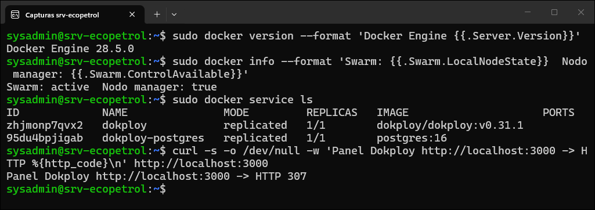
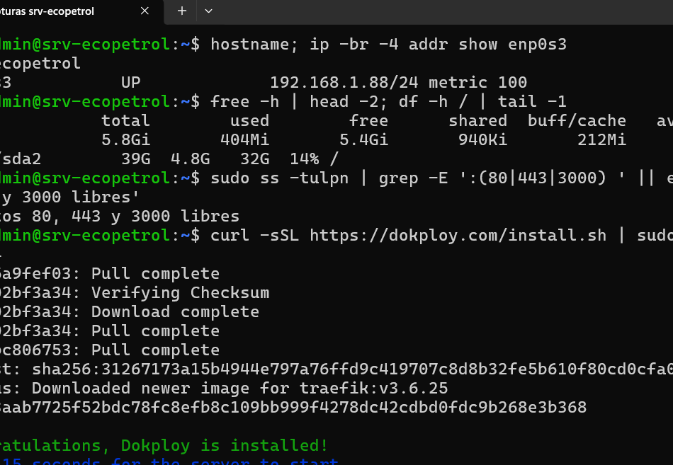


### Problemas encontrados
| Síntoma | Causa | Solución |
|---|---|---|
| Dokploy no podía clonar el repositorio | El repositorio era privado | Repositorio **público** (o conectar GitHub como proveedor en Dokploy) |
| Tras el cambio de IP de la VM, Swarm reinició dos veces `dokploy` y `dokploy-postgres` | Coincidió con el cambio de red; Swarm sigue anunciando la IP con la que se inicializó (`192.168.1.88`) | Los servicios se estabilizaron solos en ~1 min. Con la IP fija se volvió a anunciar el nodo con `--advertise-addr 172.20.10.14` (§1) |
| El panel se quedaba "cargando" para siempre y luego daba *Bad Gateway*; `journalctl -u docker` mostraba `node not registered` | Cada vez que la VM se congelaba (ver §1, Hyper-V), el nodo dejaba de enviar latidos al *dispatcher* de Swarm (5 s por defecto) y Swarm reiniciaba los servicios de Dokploy | Paliativo: `docker swarm update --dispatcher-heartbeat 60s`. No bastó con congelamientos de minutos u horas; el arreglo de fondo fue quitar Hyper-V del anfitrión (§1) |

## 3. DNS y HTTPS (A)

### Objetivo
Nombres estables para la web y el panel (`www.` y `panel.ecopetrol-ti.duckdns.org`) y HTTPS sin advertencias en los clientes.

### Instalación (comandos)

**DNS.** Subdominio `ecopetrol-ti` en DuckDNS apuntando a la IP privada del servidor. DuckDNS resuelve también cualquier subdominio (`www.`, `panel.`):
```bash
curl "https://www.duckdns.org/update?domains=ecopetrol-ti&token=<TOKEN>&ip=172.20.10.14&verbose=true"
```

**Certificado.** Dokploy solo emite Let's Encrypt con el reto HTTP, que necesita el puerto 80 alcanzable desde internet; una VM en red privada no lo es. Por eso se creó una **CA propia del laboratorio** y con ella el certificado del servidor:
```bash
bash codigo/servidor/generar-certificado.sh ecopetrol-ti.duckdns.org 172.20.10.14 ~/certs
```
- CA y servidor con ECDSA P-256; el servidor vale 397 días (máximo que aceptan los navegadores).
- SAN: `ecopetrol-ti.duckdns.org`, `*.ecopetrol-ti.duckdns.org`, `IP:172.20.10.14`.
- Las claves (`*.key`) no se suben al repositorio.

**En Dokploy:**
1. Settings → Certificates → Add Certificate: `fullchain.crt` (servidor + CA) y la clave en PKCS#8. Dokploy lo guarda en `/etc/dokploy/traefik/dynamic/certificates/<id>/` (`chain.crt`, `privkey.key`, `certificate.yml`).
2. Settings → Web Server → Server Domain: `panel.ecopetrol-ti.duckdns.org`, HTTPS on, Certificate Provider **None**. Traefik elige el certificado por SNI.

**En los clientes:** importar `ca.crt` como raíz de confianza (Windows: `certutil -addstore -f Root ca.crt`).

### Verificación (comando y salida esperada)
```bash
nslookup www.ecopetrol-ti.duckdns.org                                        # 172.20.10.14
curl -sSI --cacert ~/certs/ca.crt https://panel.ecopetrol-ti.duckdns.org     # HTTP/2 200, sin -k
echo | openssl s_client -connect panel.ecopetrol-ti.duckdns.org:443 \
  -servername panel.ecopetrol-ti.duckdns.org -CAfile ~/certs/ca.crt 2>/dev/null | grep 'Verify return code'   # 0 (ok)
```

### Capturas
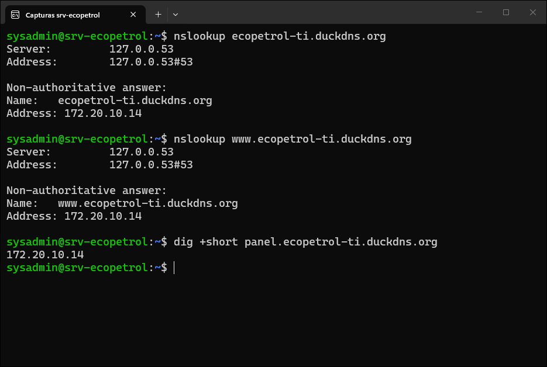
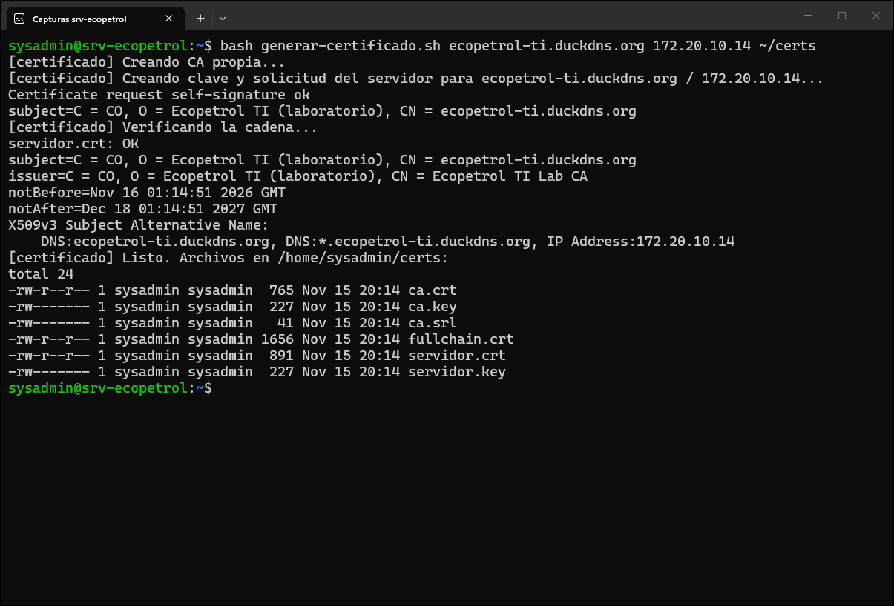


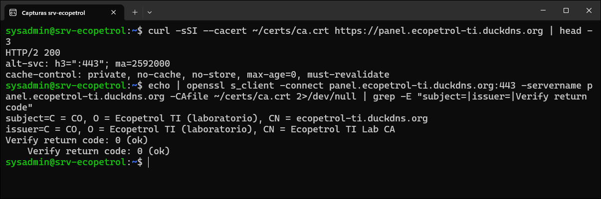

### Problemas encontrados
| Síntoma | Causa | Solución |
|---|---|---|
| No se puede usar Let's Encrypt desde Dokploy | El reto HTTP necesita que el puerto 80 sea accesible desde internet; la VM está en red privada | CA propia + certificado con SAN de dominio, comodín e IP, cargado en Dokploy con proveedor **None** |
| No se pudo agregar la línea de prueba al archivo `hosts` de Windows (`Access denied`, luego `Stream was not readable`) | El archivo tiene atributo de solo lectura y estaba bloqueado por otro proceso | Para probar en casa se apuntó DuckDNS temporalmente a la IP de casa; con la IP fija se volvió a `172.20.10.14` (2026-11-18) y se validó otra vez el HTTPS sin `-k` |
| (Riesgo previsto) `nslookup` falla en algunas redes | Protección contra *DNS rebinding* del router: descarta respuestas con IP privada | El router de casa no la tiene. Si pasa en la demo: DNS `1.1.1.1` en el cliente o archivo `hosts` |

## 4. NTP (B)

### Objetivo
Una sola fuente de hora para toda la red de la oficina. El servidor se sincroniza con `pool.ntp.org` y `south-america.pool.ntp.org` y sirve esa hora por 123/UDP solo a la subred de la demo (`172.20.10.0/28`). Así coinciden los registros de todos los servicios (clave para la investigación forense tras el ciberataque de 2026), y NIS, Samba y los certificados HTTPS no fallan por diferencias de reloj. Código y detalle en `codigo/ntp/README.md`.

### Instalación (comandos)
Contenedor propio sobre `alpine:3.20` con **chrony 4.5**, desplegado en Dokploy como **Compose tipo Docker Compose** (no *Stack*: Swarm ignora `cap_add`).

```bash
# En el servidor, antes de desplegar
sudo timedatectl set-ntp false      # el NTP del host se apaga: chrony del contenedor es la única autoridad
sudo ss -ulpn | grep ':123 '        # el puerto debe estar libre
```

En Dokploy: proyecto `Ecopetrol-TI` → Create Service → Compose `ntp`, branch `main`, Compose Path `./codigo/ntp/docker-compose.yml`, y en *Environment*:
```
ALLOW_SUBNET=172.20.10.0/28
AJUSTAR_RELOJ=true
TZ=America/Bogota
```

Decisiones de configuración:
- `cap_add: SYS_TIME`: el contenedor comparte el kernel con el host, así que chrony corrige el reloj **de todo el servidor**.
- `makestep 1.0 3`: si al arrancar el desfase es mayor que 1 s, lo corrige de un salto; después, de forma gradual.
- `local stratum 10`: si la demo se queda sin internet, el servidor sigue sirviendo su reloj y los clientes quedan sincronizados entre sí.
- `ALLOW_SUBNET` admite varias subredes separadas por coma; el *entrypoint* genera una línea `allow` por cada una. Durante las pruebas en casa se agregó `192.168.1.0/24`.

Clientes (detalle en el README del servicio):
```bash
# Linux con chrony
echo 'server 172.20.10.14 iburst prefer' | sudo tee /etc/chrony/sources.d/ecopetrol.sources
sudo systemctl restart chrony && chronyc sources        # la línea de 172.20.10.14 empieza con ^*
```
```powershell
# Windows (PowerShell como administrador)
w32tm /config /manualpeerlist:172.20.10.14 /syncfromflags:manual /reliable:no /update
w32tm /resync; w32tm /query /source                     # 172.20.10.14
```

### Verificación (comando y salida esperada)
```bash
bash codigo/ntp/verify.sh server        # 6/6 [OK]: contenedor, Leap status Normal, fuente ^*, allow, 123/udp, NTP del host inactivo
docker exec <ntp> chronyc tracking      # Stratum 3, Leap status Normal, "System time" en milisegundos
docker exec <ntp> chronyc clients       # lista los equipos que consultaron la hora
```
Resultado en el servidor (2026-11-18): estrato 3, `Leap status: Normal`, desfase de **1,6 ms**, 5 fuentes válidas. Cliente Windows (`172.20.10.2`): `w32tm /query /source` → `172.20.10.14`, estrato 4, y `w32tm /stripchart` con desfases de **0,1 ms**; en el servidor, `chronyc clients` lo lista. Cliente Linux `cli-icpet` (`172.20.10.13`): `chronyc sources` muestra `^* 172.20.10.14`, estrato 4, `Leap status: Normal`, y `verify.sh client 172.20.10.14` pasa 2/2.

### Capturas
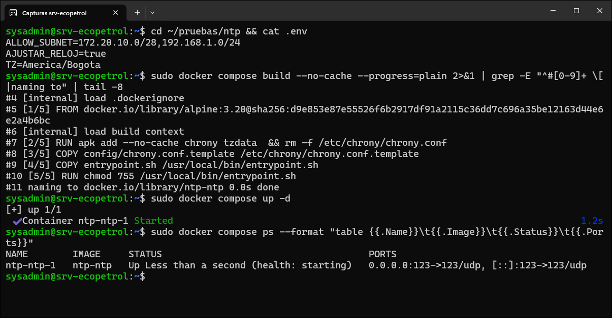
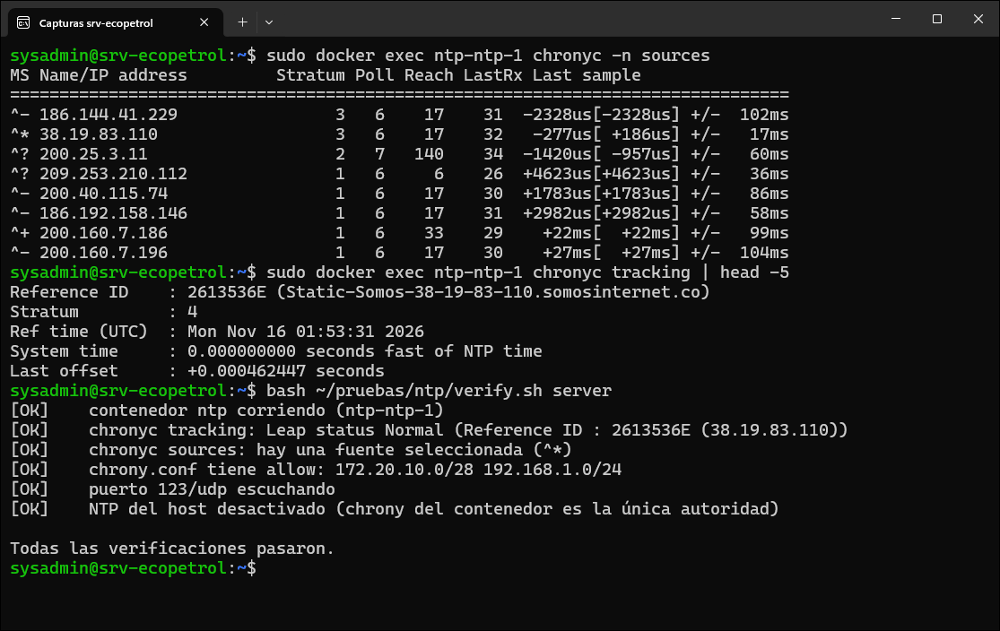
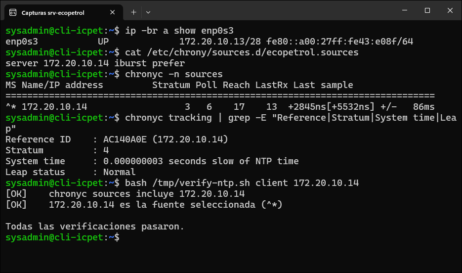
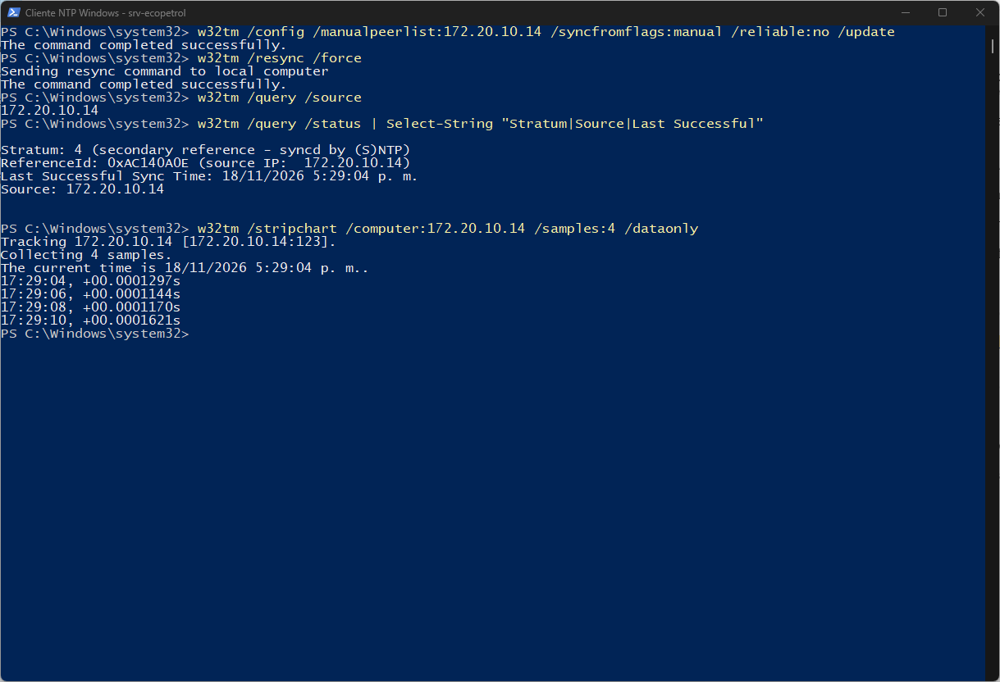
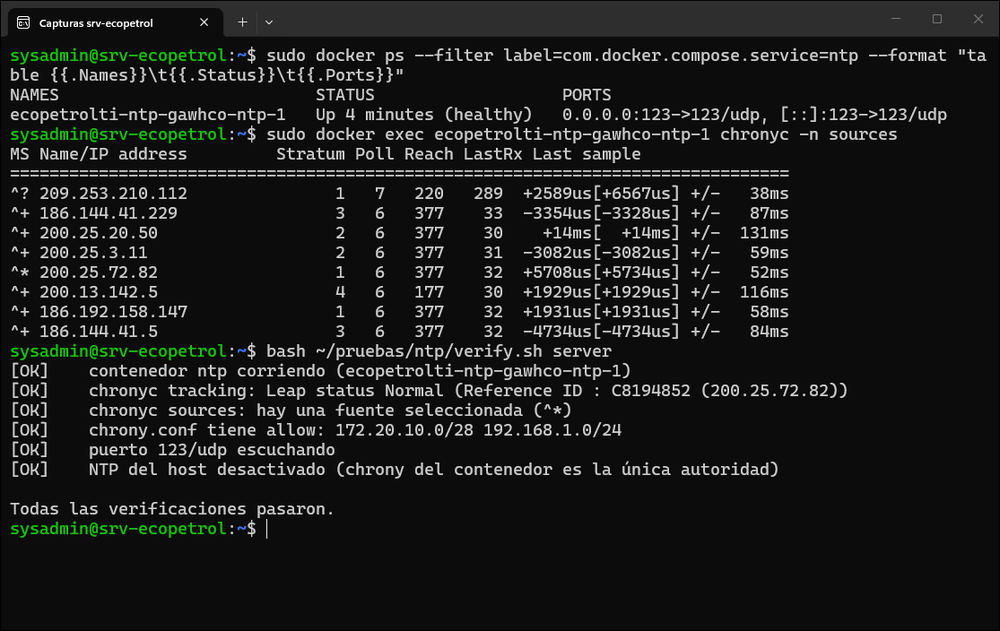

### Problemas encontrados
| Síntoma | Causa | Solución |
|---|---|---|
| En los logs de chrony: `System clock was stepped by 60954.902717 seconds` (casi 17 h) | La VM se había congelado y VirtualBox la dejó en estado *guardado* al apagar Windows; al reanudarla, su reloj seguía en la hora en que se detuvo | `makestep 1.0 3` corrigió el reloj de un salto al arrancar chrony. Sin un servidor NTP en la red, todos los registros de esas horas habrían quedado con la fecha equivocada |
| En cada arranque de la VM, chrony corregía unos 6 s (`stepped by 5.937311 seconds`, `6.492441 seconds`) | La VM toma la hora inicial del reloj de Windows, que estaba unos 4-6 s desfasado (`w32tm /stripchart` contra el servidor mostraba `+04.15s`) | Lo corrige `makestep`. La causa de fondo: el servicio de hora de Windows estaba **deshabilitado** (`w32time` en *Disabled*, `Type=NoSync`), así que el anfitrión no sincronizaba con nada. Al configurarlo como cliente del servidor (`w32tm`, arriba) el desfase pasó de +4,15 s a 0,1 ms |
| El contenedor de prueba y el de Dokploy no pueden estar a la vez | Los dos publican 123/UDP: el segundo falla con `address already in use` | Apagar el de prueba (`docker compose down` en `~/pruebas/ntp`) antes de desplegar en Dokploy |
| (Previsto en el diseño) `adjtimex(0x8001) failed: Operation not permitted` | Falta `SYS_TIME`, o la app se crea como *Stack*, que ignora `cap_add` | `cap_add: SYS_TIME` y app tipo **Docker Compose** |

## 5. Base de datos (B)

### Objetivo
Guardar la información del portal (sedes, noticias y la guía de servicios TI) en una base **PostgreSQL 16** administrada por Dokploy, para que la web no tenga datos escritos a mano en HTML. La base solo es accesible desde la red interna de Docker: no se publica ningún puerto.

### Instalación (comandos)
En Dokploy: proyecto `Ecopetrol-TI` → Create Service → **Database → PostgreSQL**:

| Campo | Valor |
|---|---|
| Name | `ecopetrol-db` (servicio `ecopetrolti-ecopetroldb-5fzqvb`) |
| Database Name / User | `ecopetrol` / `ecopetrol_app` |
| Contraseña | generada, fuerte; solo en Dokploy |
| Imagen | `postgres:16` (16.16) |
| External Port | **desactivado** |

Deploy, y copiar la **Internal Connection URL** (`postgresql://ecopetrol_app:<clave>@ecopetrolti-ecopetroldb-5fzqvb:5432/ecopetrol`) a la variable `DATABASE_URL` de la web (§6).

El esquema y los datos no se cargan a mano: la API ejecuta `codigo/web/api/db/schema.sql` y `seed.sql` al arrancar. Son idempotentes (`CREATE TABLE IF NOT EXISTS`, `ON CONFLICT DO NOTHING`), así que redesplegar no duplica filas.

| Tabla | Campos |
|---|---|
| `sedes` | `id`, `nombre` (único), `ciudad`, `departamento`, `tipo`, `descripcion` |
| `noticias` | `id`, `titulo` (único), `resumen`, `fecha`, `fuente_url` |
| `servicios_ti` | `id`, `nombre` (único), `protocolo`, `puerto`, `como_conectar` |

Los datos viven en el volumen `ecopetrolti-ecopetroldb-5fzqvb-data`; los contenedores de la web no tienen estado. Dokploy permite programar backups de la base (pestaña *Backups*).

### Verificación (comando y salida esperada)
```bash
c=$(sudo docker ps -qf name=ecopetrolti-ecopetroldb)
sudo docker exec $c psql -U ecopetrol_app -d ecopetrol -c '\dt'      # noticias, sedes, servicios_ti
sudo docker exec $c psql -U ecopetrol_app -d ecopetrol \
  -c 'select (select count(*) from sedes) sedes, (select count(*) from noticias) noticias, (select count(*) from servicios_ti) servicios_ti;'
# sedes 5 | noticias 5 | servicios_ti 6
sudo docker service inspect ecopetrolti-ecopetroldb-5fzqvb --format '{{json .Endpoint.Ports}}'   # null: sin puertos publicados
curl -s https://www.ecopetrol-ti.duckdns.org/api/health                                          # {"status":"ok","db":"ok"}
```

### Capturas
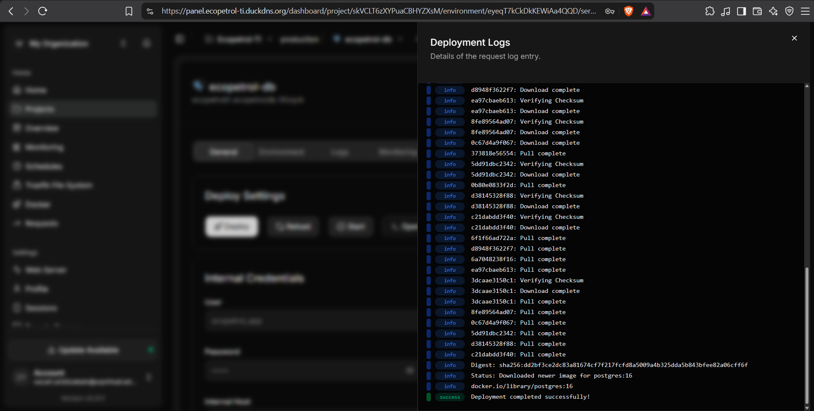
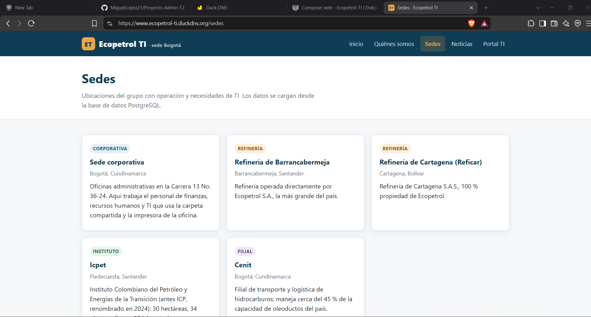

### Problemas encontrados
| Síntoma | Causa | Solución |
|---|---|---|
| `docker service ps` muestra dos tareas de la base en `Failed` con `No such container: ecopetrolti-ecopetroldb-5fzqvb.1...` | La base corre como servicio de Swarm; cuando la VM se congelaba (Hyper-V, §1), Swarm perdía el contenedor y creaba una tarea nueva | Swarm la recreó sola y **no se perdieron datos**, porque están en el volumen `...-data`, no en el contenedor. El arreglo de fondo fue quitar Hyper-V del anfitrión (§1) |
| Con la base caída, `/api/health` se quedaba colgado en lugar de avisar (encontrado en las pruebas) | El *pool* de `pg` de la API no tenía tiempo límite de conexión | `connectionTimeoutMillis: 3000` y `query_timeout: 5000`: ahora responde **503** con `"db":"error"` en 3 s |
| El host de la base no es `ecopetrol-db` sino `ecopetrolti-ecopetroldb-5fzqvb` | Dokploy agrega el proyecto y un sufijo aleatorio al nombre del servicio | Usar siempre la **Internal Connection URL** que muestra Dokploy, no armarla a mano |

## 6. Web (B)

### Objetivo
Portal HTTPS de la sede Bogotá en `https://www.ecopetrol-ti.duckdns.org`: información corporativa, sedes y noticias leídas de la base de datos (§5), y un "Portal TI" con la forma de conectarse a cada servicio de la red. Código y detalle en `codigo/web/README.md`.

### Instalación (comandos)
Dos contenedores en un Compose de Dokploy, sin puertos publicados (todo entra por Traefik):

```
Navegador ──HTTPS──> Traefik (Dokploy) ──> ecopetrol-web (Nginx 1.27 :80)
                                             ├── /       → sitio estático (5 páginas)
                                             └── /api/*  → ecopetrol-api (Node 20 :3000) ──> PostgreSQL (§5)
```

En Dokploy: Create Service → **Compose** `web`, tipo Docker Compose, branch `main`, Compose Path `./codigo/web/docker-compose.yml`.
- *Environment*: `DATABASE_URL=<Internal Connection URL de §5>`, `SERVER_IP=172.20.10.14`, `DOMINIO=ecopetrol-ti.duckdns.org`.
- *Domains*: host `www.ecopetrol-ti.duckdns.org`, path `/`, service **`ecopetrol-web`**, puerto **80**, HTTPS activado, Certificate Provider **None** (Traefik usa el certificado de la CA propia, §3).
- Deploy. En los logs de la API: `[db] esquema y semilla listos: 5 sedes, 5 noticias, 6 servicios TI`.

**Autodeploy.** Como el servidor tiene IP privada, GitHub no puede llamar al webhook de Dokploy. El servidor revisa GitHub cada minuto (`git ls-remote`) con un timer de systemd y, si `main` cambió, llama él mismo al webhook con el formato de GitHub (`codigo/web/autodeploy/`, instalación en el README de la web §6):
```bash
sudo systemctl enable --now autodeploy-sondeo.timer
journalctl -u autodeploy-sondeo        # Cambio en main: 406053e -> 3ee778b / Dokploy: Compose deployed successfully
```
La URL del webhook es un secreto: queda en `/etc/ecopetrol/autodeploy.env` (solo root), no en el repositorio.

### Verificación (comando y salida esperada)
```bash
bash codigo/web/verify.sh server                          # 7/7 [OK]: contenedores, nginx -t, health, Nginx→API, red dokploy-network, sin puertos publicados
CA_CERT=~/certs/ca.crt bash codigo/web/verify.sh client   # 4/4 [OK]: HTTPS 200 sin -k, db ok, 5 sedes, cabeceras de seguridad
curl -s https://www.ecopetrol-ti.duckdns.org/api/health   # {"status":"ok","db":"ok"}
```
Prueba de autodeploy (2026-11-18): el push del commit `3ee778b` se desplegó solo en menos de 1 minuto (despliegue de 4 s en Dokploy).

### Capturas
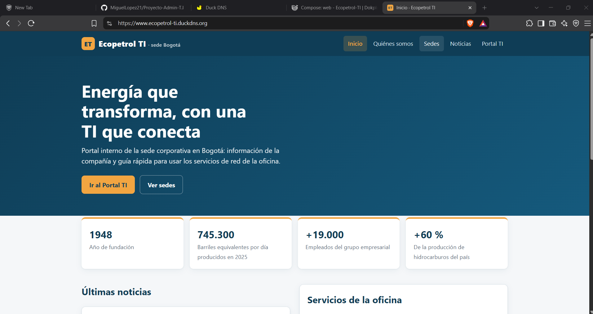

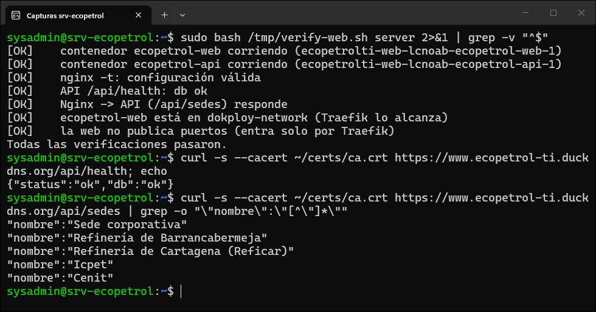
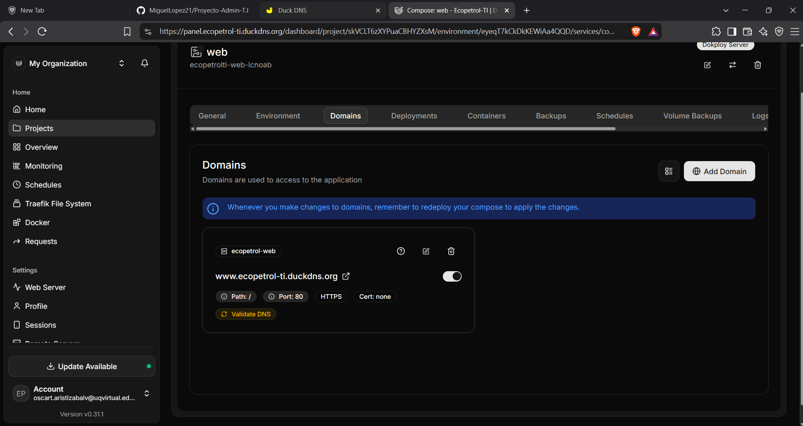
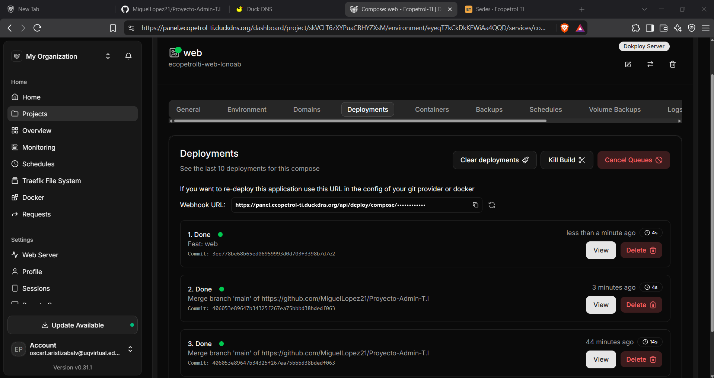
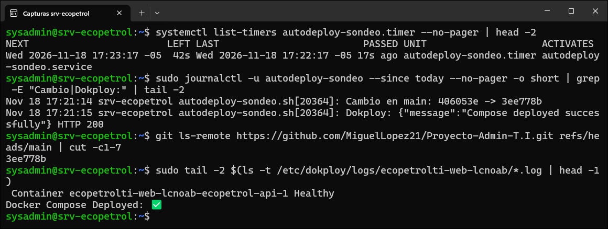

### Problemas encontrados
| Síntoma | Causa | Solución |
|---|---|---|
| `/api/*` devolvía **504** después de redesplegar o reiniciar la API (encontrado en las pruebas) | Nginx resolvía el nombre `ecopetrol-api` una sola vez al arrancar, y la API volvía con otra IP | `resolver 127.0.0.11 valid=10s` y `proxy_pass` con variable, para que Nginx vuelva a resolver el nombre |
| El autodeploy con el webhook de GitHub no se puede usar | GitHub tendría que conectarse a `172.20.10.14`, una IP privada detrás del hotspot | Sondeo desde el servidor (`autodeploy-sondeo.timer`): solo hace conexiones de salida y no hay que abrir nada a internet |
| El webhook de Dokploy respondía `301 {"message":"Branch Not Match"}` | Dokploy lee la rama del campo `ref` del cuerpo y la cabecera `X-GitHub-Event`; una llamada simple no los trae | El script envía `X-GitHub-Event: push` y un cuerpo con el formato de GitHub (`ref`, `after`, mensaje y archivos del commit) |
| `verify.sh client` fallaba en el servidor con `curl failed to verify the legitimacy of the server` | La VM no tenía la CA del laboratorio en su almacén de certificados | `CA_CERT=~/certs/ca.crt`, o instalar la CA en el sistema (`update-ca-certificates`) |

## 7. NIS (C)

### Objetivo
Autenticación centralizada para los equipos Linux de la oficina y de los laboratorios del Icpet. Las cuentas se crean una sola vez en `srv-ecopetrol` (servidor NIS maestro del dominio `ecopetrol.local`) y cualquier cliente las usa para iniciar sesión, con los mismos UID y GID que NFS (§8) y Samba (§9). Así, al dar de baja a un empleado se borra en un solo lugar, y los permisos de los archivos compartidos coinciden en todos los equipos. Código y detalle en `codigo/nis/README.md`.

### Instalación (comandos)
NIS corre en el **host**, no en Docker, porque depende de `rpcbind` y de RPC. Paquetes de Ubuntu 24.04: `nis` 4.5 (`ypserv` 4.2, `ypbind-mt` 2.7.2, `libnss-nis` 3.1) y `rpcbind` 1.2.6.

```bash
# Servidor (srv-ecopetrol), desde la raíz del repositorio
cp codigo/nis/.env.example codigo/nis/.env      # poner la contraseña de demo en DEMO_PASSWORD (no se sube)
sudo bash codigo/nis/install.sh codigo/nis/.env
```

`install.sh` es idempotente (se ejecutó dos veces seguidas sin errores ni duplicados) y hace, en orden:
1. Fija el dominio (`/etc/defaultdomain`) y precarga `debconf` para que `apt` no haga preguntas.
2. Instala `nis` y `rpcbind`. Antes espera a que `unattended-upgrades` libere `dpkg` y `debconf` (ver *Problemas*).
3. Crea los grupos y usuarios de `config/grupos.csv` y `config/usuarios.csv` (tabla de §0) con homes en `/home/nis/<usuario>`. Si una cuenta ya existe con otro UID o GID, se detiene en vez de dejar IDs inconsistentes.
4. Escribe `/etc/default/nis` y `/etc/ypserv.securenets`, ajusta `/var/yp/Makefile`, arranca `rpcbind`, `ypserv` y `yppasswdd` y genera los mapas (`ypinit -m` la primera vez y `make -C /var/yp` después).

Decisiones de configuración:
- **Puertos fijos** (`YPSERVARGS="-p 834"`, `YPPASSWDDARGS="--port 835"`): RPC asigna puertos al azar; fijarlos permite abrirlos en el cortafuegos (`ufw.sh`, `PUERTOS_HOST="111 834 835 2049/tcp"`) y documentarlos en la tabla de §0.
- **`securenets`**: solo `127.0.0.0/8` y la subred de la demo `172.20.10.0/255.255.255.240`. Se quita la línea `0.0.0.0 0.0.0.0`, que deja consultar los mapas a cualquiera.
- **`MINUID=2000` y `MINGID=2000`** en `/var/yp/Makefile` (la guía proponía 1000): con 1000 se exportaría `sysadmin` (UID 1000, administrador del servidor), con su hash de contraseña, a toda la red, y chocaría con el usuario local UID 1000 de cada cliente (`cli-icpet` tiene uno).
- **`NISCLIENT=false`** en el servidor: no se consulta a sí mismo; sus cuentas ya están en `/etc/passwd`.
- Regla de operación: cada vez que se crea o cambia un usuario en el servidor hay que ejecutar `sudo make -C /var/yp`; si no, los clientes no ven el cambio.

```bash
# Cliente Linux (cli-icpet)
sudo bash codigo/nis/client-setup.sh codigo/nis/.env
```

`client-setup.sh` instala `nis`, `rpcbind` y `openssh-server`; escribe `/etc/yp.conf` (`domain ecopetrol.local server 172.20.10.14`); agrega `nis` a `passwd`, `group`, `shadow` y `netgroup` en `/etc/nsswitch.conf` (con respaldo y sin duplicar); y arranca `ypbind`. Además aplica dos ajustes propios de Ubuntu 24.04:
- **Drop-in de `systemd-logind`** con `IPAddressAllow=any`: la unidad trae `IPAddressDeny=any`, que bloquea las consultas NIS durante el login y lo deja colgado.
- **`nscd` sin caché de grupos** (`enable-cache group no`): el paquete `nis` instala `nscd`, y su caché de grupos ocultaba los grupos secundarios (ver *Problemas*).

Los homes de los usuarios NIS no se crean en el cliente: llegan montados por NFS (§8).

### Verificación (comando y salida esperada)
```bash
bash codigo/nis/verify.sh server                                  # 9/9 [OK]
DEMO_PASSWORD='…' bash codigo/nis/verify.sh client 172.20.10.14   # 12/12 [OK] (con sshpass instalado)
rpcinfo -p localhost | grep yp          # ypserv en 834 (tcp/udp, v1 y v2) y yppasswdd en 835
ypwhich                                  # 172.20.10.14   (en el cliente)
id admin.ti                              # uid=2001(admin.ti) gid=3001(ti) groups=3001(ti),3002(icpet),3003(administrativa)
ssh lab.icpet1@localhost                 # pide la contraseña NIS; pwd → /home/nis/lab.icpet1
```

- `verify.sh server` comprueba: servicios activos, puertos 834 y 835, dominio, `securenets` cerrado, los 5 usuarios del CSV en el mapa `passwd` y que no se exporta ninguna cuenta con UID menor que 2000.
- `verify.sh client` comprueba: `ypbind`, `ypwhich`, `nsswitch`, el drop-in de `logind`, UID, home y grupos, y hace la **prueba de autenticación real** de la rúbrica: login SSH de `lab.icpet1` con su contraseña NIS (`pwd` = `/home/nis/lab.icpet1`) y rechazo de una contraseña incorrecta (`Permission denied`, y `Failed password for lab.icpet1` en el journal de `sshd`).

Resultado (2026-11-20, `srv-ecopetrol` + `cli-icpet`): servidor **9/9** y cliente **12/12**, también después de reiniciar las dos VM. Las pruebas se hicieron con las IP de la demo (`.14` y `.13` en `172.20.10.0/28`) sobre una red *host-only* de VirtualBox, porque ese día no había hotspot.

### Capturas
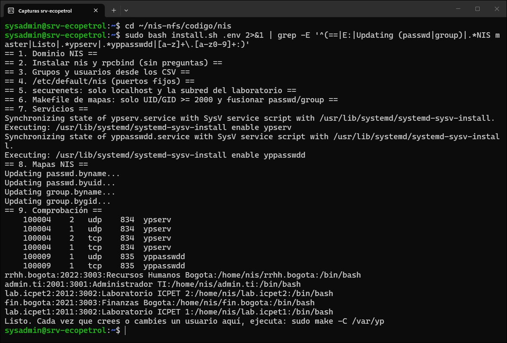
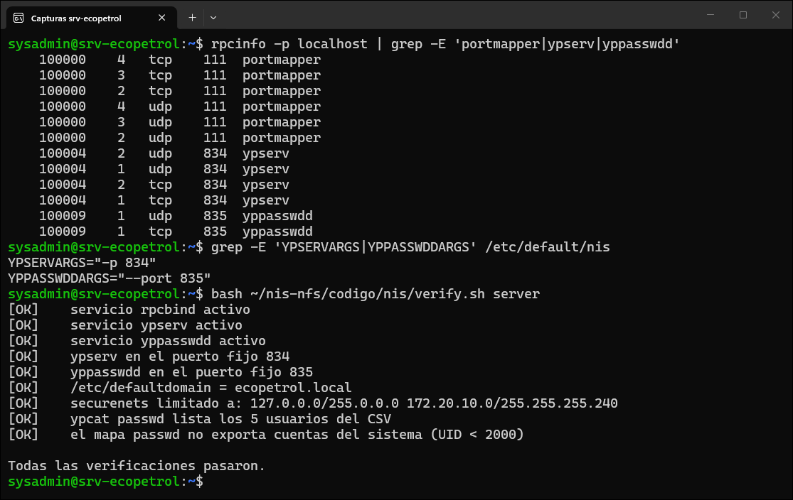
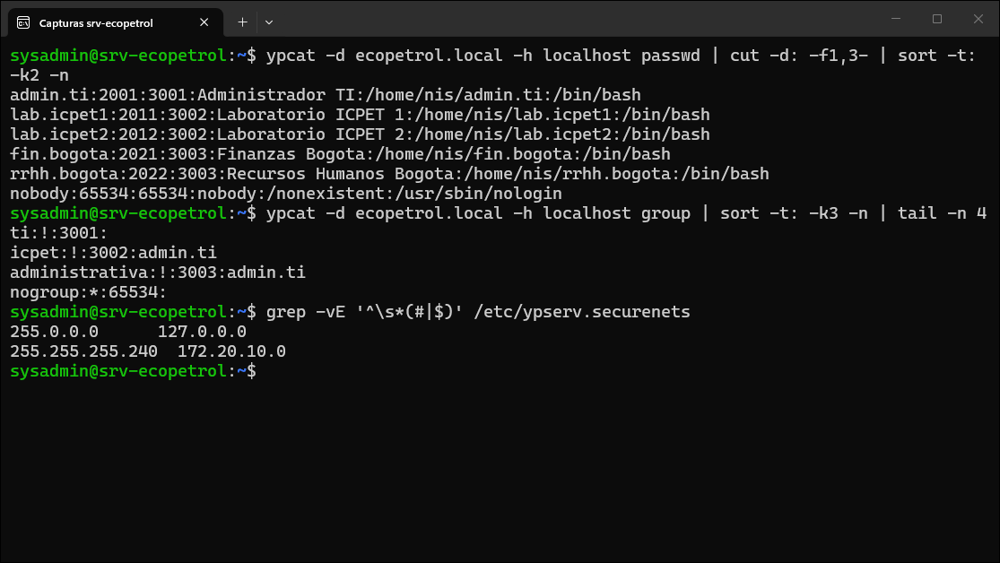
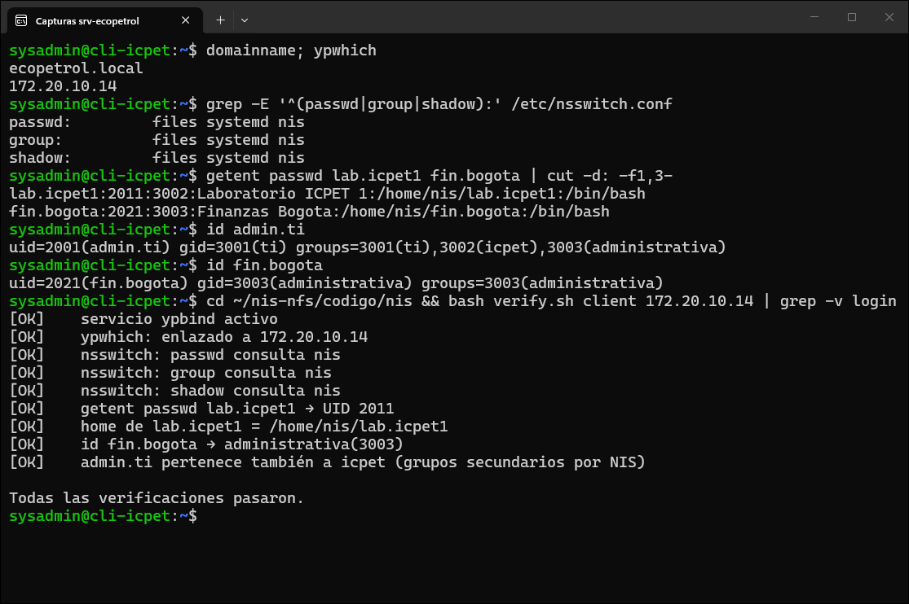
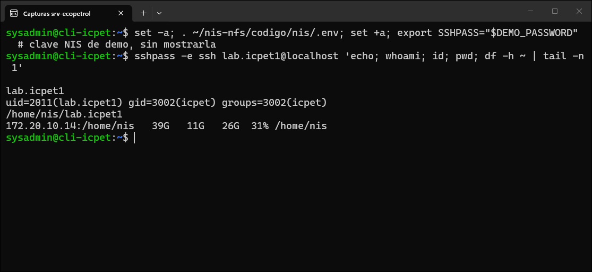
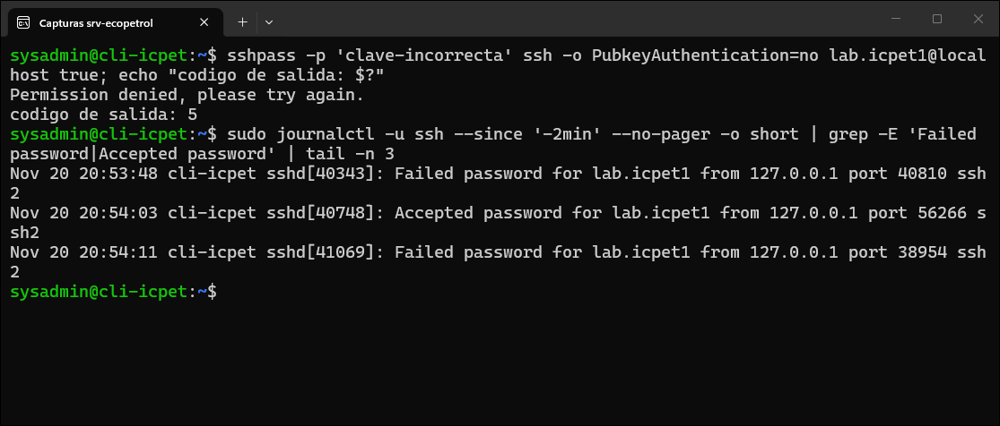

### Problemas encontrados
| Síntoma | Causa | Solución |
|---|---|---|
| `install.sh` mostraba la ayuda de `useradd` y no creaba ningún usuario; antes ya fallaba al leer los grupos | La primera versión llamaba `useradd "${args[@]}"` sin el nombre del usuario, y buscaba `config/grupos.csv` cuando el archivo se llamaba `grupo.csv` | `useradd "${args[@]}" "$usuario"` y archivo renombrado. Se detectó al probar en la VM: el script nunca se había ejecutado completo |
| Al correr `install.sh` por segunda vez se cortaba en el paso 3, sin mensaje | `[[ -n "$extras" ]] && usermod …` devuelve 1 cuando el usuario no tiene grupos extra; con `set -e` y `pipefail`, eso aborta el script | `if [[ -n "$extras" ]]; then usermod …; fi`. Ahora dos ejecuciones seguidas terminan con código 0 |
| `E: Could not get lock /var/lib/dpkg/lock-frontend. It is held by process … (unattended-upgr)`, y en el cliente `debconf: config.dat is locked by another process` | Recién encendidas las VM con internet, `unattended-upgrades` estaba instalando actualizaciones | Los scripts esperan a que se liberen `dpkg` y `debconf` (`fuser`, hasta 10 min) y usan `apt-get -o DPkg::Lock::Timeout=600`. En la demo pasaría lo mismo justo después de encender |
| En el cliente, `id admin.ti` mostraba solo `groups=3001(ti)`, aunque `getent group icpet` sí lo listaba como miembro | `nscd` (instalado como dependencia de `nis`) devolvía los grupos secundarios incompletos. Con `nscd` detenido, `id` mostraba `3001,3002,3003`; invalidar la caché (`nscd -i group`) no bastaba | `enable-cache group no` en `/etc/nscd.conf` (respaldo en `nscd.conf.orig`). Sin esto, `admin.ti` no podría entrar a la carpeta NFS del grupo `icpet` |
| El primer login SSH de `lab.icpet1` respondía `Could not chdir to home directory /home/nis/lab.icpet1: No such file or directory` | La autenticación NIS ya funcionaba, pero los homes todavía no estaban montados por NFS | Configurar NFS en el cliente (§8). Después, `pwd` devuelve `/home/nis/lab.icpet1` |
| (Diseño) Los hashes de las contraseñas viajan sin cifrar en los mapas NIS (`MERGE_PASSWD=true`) y cualquiera de la subred puede ver el mapa `passwd` | Limitación propia de NIS | Se acota con `securenets` (solo la /28) y el cortafuegos; ni los scripts ni las capturas muestran la columna del hash. En producción se usaría LDAP con Kerberos |

## 8. NFS (C)

### Objetivo
Archivos compartidos para los equipos Linux con permisos por grupo. El servidor exporta dos recursos por **NFSv4**: `/srv/nfs/ecopetrol`, la carpeta de trabajo de los laboratorios del Icpet, a la que solo entra el grupo `icpet`; y `/home/nis`, los homes de los usuarios NIS, para que cada usuario encuentre sus archivos en cualquier equipo. Los permisos funcionan porque NIS (§7) da los mismos UID y GID en el servidor y en los clientes. Código y detalle en `codigo/nfs/README.md`.

### Instalación (comandos)
NFS corre en el **host** porque usa el servidor `nfsd` del kernel. Paquetes de Ubuntu 24.04: `nfs-kernel-server` y `nfs-common` 2.6.4. Requiere NIS instalado antes: `install.sh` se detiene si no existe el grupo `icpet` (3002).

```bash
# Servidor (srv-ecopetrol)
cp codigo/nfs/.env.example codigo/nfs/.env     # SERVER_IP=172.20.10.14, SUBRED=172.20.10.0/28, NFS_DOMAIN=ecopetrol.local
sudo bash codigo/nfs/install.sh codigo/nfs/.env

# Cliente (cli-icpet), después de configurar NIS
sudo bash codigo/nfs/client-setup.sh codigo/nfs/.env
```

`/etc/exports` generado (sin duplicar líneas si se ejecuta otra vez):
```
/srv/nfs/ecopetrol  172.20.10.0/28(rw,sync,no_subtree_check,root_squash)
/home/nis           172.20.10.0/28(rw,sync,no_subtree_check,root_squash)
```

`/etc/fstab` del cliente:
```
172.20.10.14:/srv/nfs/ecopetrol  /mnt/ecopetrol  nfs4  defaults,_netdev  0 0
172.20.10.14:/home/nis           /home/nis       nfs4  defaults,_netdev  0 0
```

Decisiones de configuración:
- **`root_squash` y no `no_root_squash`**, que es lo que trae la guía del enunciado. Con `no_root_squash`, el root de cualquier equipo de la red sería root sobre los archivos del servidor. Con `root_squash`, el root del cliente se convierte en `nobody` y no entra a la carpeta del Icpet ni a los homes.
- **`/srv/nfs/ecopetrol` con `2770 root:icpet`**. El bit **setgid** hace que todo archivo nuevo herede el grupo `icpet`, así que los compañeros del laboratorio pueden editar lo que crea otro. Los demás no pueden ni listar la carpeta.
- **Homes `700`**, de su dueño: otro usuario NIS no puede leer el home ajeno.
- **Solo la /28 de la demo** en los exports, no una /24.
- **`Domain = ecopetrol.local`** en `/etc/idmapd.conf`, igual en el servidor y en el cliente, para que NFSv4 traduzca bien los dueños de los archivos.
- **`_netdev`** en el `fstab`: el cliente monta cuando la red está lista. Se comprobó reiniciando las dos VM: los montajes vuelven solos. Se monta en `/home/nis` y no sobre `/home`, para no ocultar los homes locales del cliente.

### Verificación (comando y salida esperada)
```bash
sudo bash codigo/nfs/verify.sh server                  # 7/7 [OK]
sudo bash codigo/nfs/verify.sh client 172.20.10.14     # 9/9 [OK]
sudo exportfs -v                                       # los 2 exports con root_squash, solo 172.20.10.0/28
findmnt -t nfs4                                        # /mnt/ecopetrol y /home/nis desde 172.20.10.14 (vers=4.2)
```

`verify.sh client` comprueba la tabla de permisos que pide la rúbrica, creando un archivo de prueba que borra al final:

| Acción en el cliente | Resultado obtenido |
|---|---|
| `lab.icpet1` crea un archivo en `/mnt/ecopetrol/ensayos` | OK; dueño `lab.icpet1:icpet` (grupo heredado por setgid) |
| `lab.icpet2` (mismo grupo) lo modifica | OK |
| `admin.ti` (grupo extra `icpet`) lista la carpeta | OK |
| `fin.bogota` (grupo `administrativa`) hace `ls`, `touch` o `cat` | `Permission denied` |
| `root` del cliente crea un archivo o lista `/mnt/ecopetrol` | `Permission denied`, por `root_squash` |
| `root` del cliente lee `/home/nis/lab.icpet1/.bashrc` | `Permission denied` |
| `lab.icpet1` entra por SSH (§7) | Su home `/home/nis/lab.icpet1` está servido por NFS (`172.20.10.14:/home/nis`) |

Resultado (2026-11-20): servidor **7/7** y cliente **9/9**, también después de reiniciar las dos VM.

### Capturas
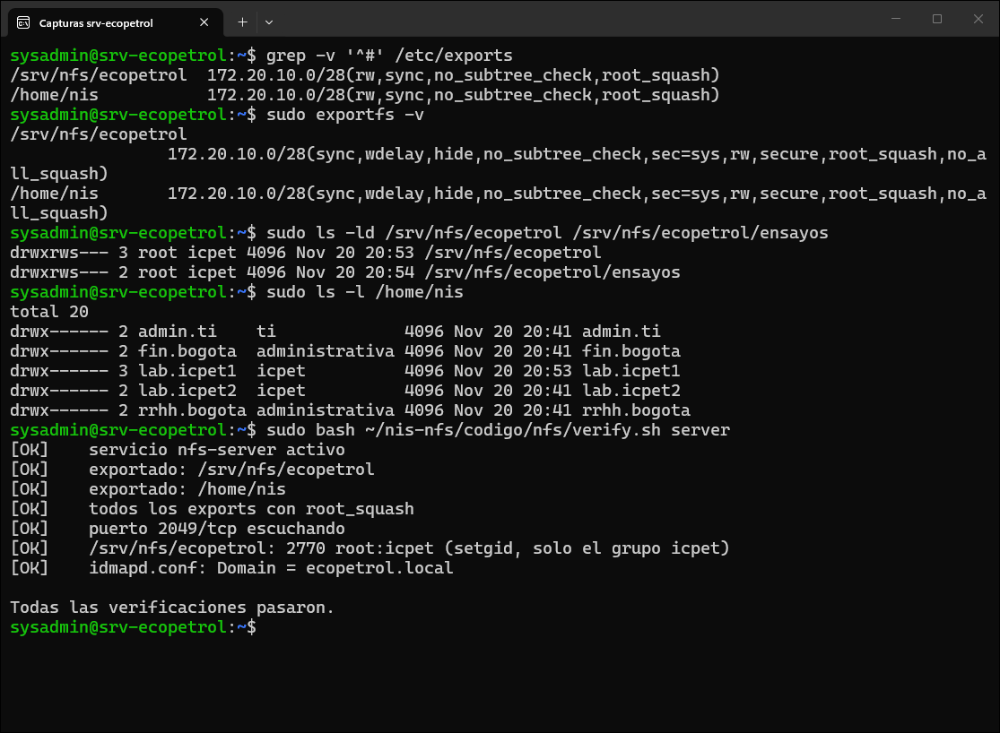
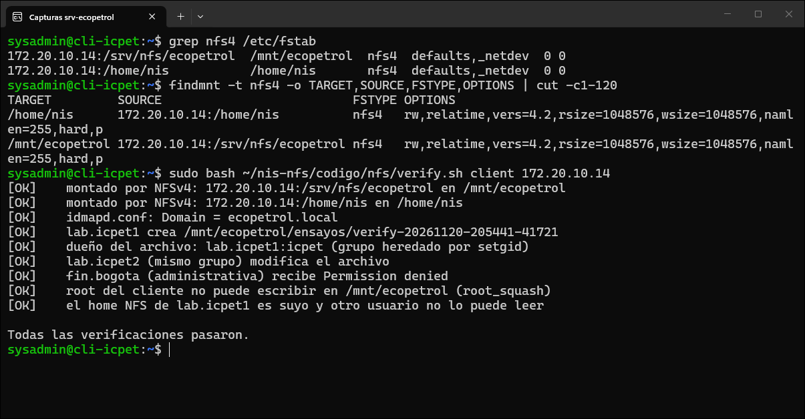
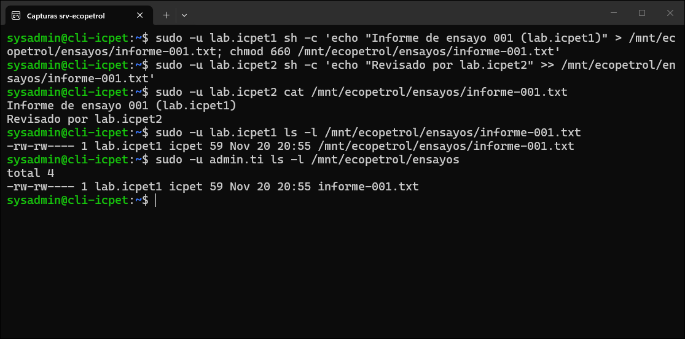
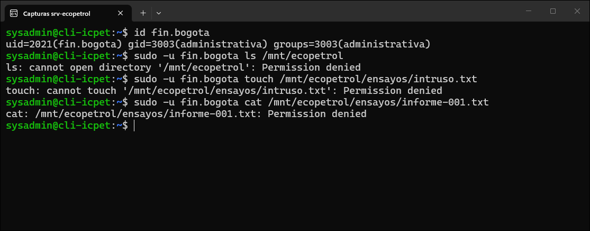
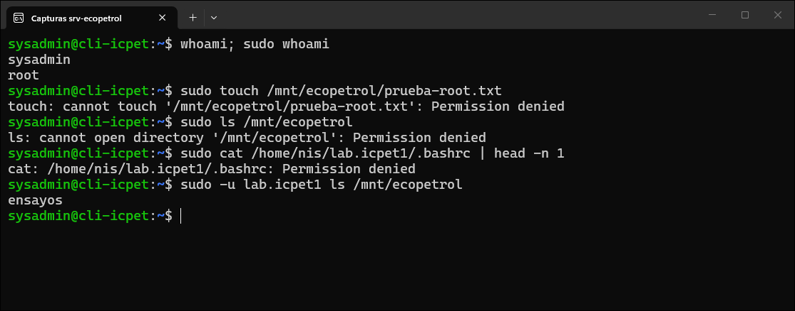

### Problemas encontrados
| Síntoma | Causa | Solución |
|---|---|---|
| Los `.env.example` de NIS y NFS apuntaban a `192.168.100.178` con una subred `/24` | Se escribieron con la red de la casa de quien los desarrolló | `SERVER_IP=172.20.10.14` y `SUBRED=172.20.10.0/28` (en NIS, máscara `255.255.255.240`). Con la /24, los exports y `securenets` no habrían correspondido a la red real |
| En el servidor, `ls -ld /srv/nfs/ecopetrol/ensayos` como `sysadmin` respondía `Permission denied` | Es el comportamiento esperado: `sysadmin` no pertenece a `icpet` y la carpeta es `2770` | Revisar con `sudo` o con un usuario del grupo. Confirma que los permisos se aplican también en el servidor |
| `admin.ti` no habría podido entrar a `/mnt/ecopetrol` aunque es miembro de `icpet` | La caché de grupos de `nscd` en el cliente ocultaba sus grupos secundarios (§7) | `client-setup.sh` de NIS la desactiva; ahora `sudo -u admin.ti ls /mnt/ecopetrol/ensayos` funciona |
| (Diseño) La guía del enunciado exporta con `no_root_squash` | Con esa opción, el root de cualquier cliente es root en el servidor | Se usa `root_squash`; la captura `nfs/05` muestra que el root del cliente queda sin acceso |

## 9. Samba (D)

### Objetivo
Compartir la carpeta `administrativa` con clientes Windows, macOS y Linux, con autenticación por usuario, sin invitados y sin SMB1. Corre en un contenedor Alpine 3.20 (`codigo/samba/`), desplegado con Dokploy.

### Instalación (comandos)
```bash
cd codigo/samba
cp .env.example .env            # editar SMB_PASSWORD
docker compose up -d --build
docker compose logs -f samba
```
En Dokploy: servicio Compose, *Compose Path* `./codigo/samba/docker-compose.yml`, variables en la pestaña *Environment*.

### Verificación (comando y salida esperada)
```bash
bash codigo/samba/verify.sh server            # [OK] en las 4 comprobaciones, exit 0
bash codigo/samba/verify.sh client SERVER_IP   # con SMB_PASSWORD exportada
```
- `docker exec <samba> pdbedit -L` lista `fin.bogota`, `rrhh.bogota` y `admin.ti`.
- `smbclient //SERVER_IP/administrativa -U lab.icpet1 -c ls` → `NT_STATUS_LOGON_FAILURE` o `ACCESS_DENIED`.
- Windows: `net use Z: \\SERVER_IP\administrativa /user:ECOPETROL\fin.bogota *` y crear un archivo.

### Capturas
_Pendiente: `samba/01_build-local`, `02_testparm`, `03_pdbedit-usuarios`, `04_windows-explorador`, `05_net-use-Z`, `06_escribir-archivo`, `07_usuario-no-autorizado-denegado`, `08_mac-o-linux-smbclient`._

### Problemas encontrados
_Pendiente: completar con los problemas reales de las pruebas (mínimo 2). Candidatos a revisar: `bind failed on port 445`, error 1219 de Windows por credencial en caché, permisos al escribir._

## 10. CUPS (D)

### Objetivo
Publicar una impresora virtual PDF (`Ecopetrol-Bogota-PDF`) compartida por IPP, administrable solo por `lpadmin`, accesible desde la subred de la oficina. Corre en un contenedor Debian 12 (`codigo/cups/`), desplegado con Dokploy.

### Instalación (comandos)
```bash
cd codigo/cups
cp .env.example .env            # editar CUPS_ADMIN_PASSWORD y ALLOW_SUBNET
docker compose up -d --build
docker compose logs -f cups
```
En Dokploy: servicio Compose, *Compose Path* `./codigo/cups/docker-compose.yml`.

### Verificación (comando y salida esperada)
```bash
bash codigo/cups/verify.sh server             # scheduler is running, cola idle/enabled, :631 abierto
bash codigo/cups/verify.sh client SERVER_IP   # request id is Ecopetrol-Bogota-PDF-N
docker exec <cups> ls -l /var/spool/cups-pdf/ANONYMOUS   # aparece el PDF nuevo
```
- Administración web: `https://SERVER_IP:631/admin` con `admin.ti` (certificado autofirmado, se acepta la advertencia).
- Windows: agregar la impresora por `http://SERVER_IP:631/printers/Ecopetrol-Bogota-PDF` con *Microsoft PS Class Driver* e imprimir una página de prueba.

### Capturas
_Pendiente: `cups/01_web-admin`, `02_cola-compartida`, `03_windows-agregar-impresora`, `04_pagina-prueba`, `05_lpstat-cola`, `06_pdf-generado`._

### Problemas encontrados
_Pendiente: completar con los problemas reales de las pruebas (mínimo 2). Candidatos a revisar: `400 Bad Request` sin `ServerAlias *`, `403` por usar `@LOCAL`, cola en *stopped*, driver en Windows._

## 11. Integración y pruebas cruzadas (A)

Orden de despliegue y comandos en `codigo/servidor/CHECKLIST.md` §7. Estado al 2026-11-18 (servidor en `172.20.10.14`):

| Servicio | Despliegue | `verify.sh server` | Prueba de cliente | Captura |
|---|---|---|---|---|
| NTP | Dokploy (Compose) | 6/6 OK | Linux `cli-icpet`: `^*` y `verify.sh client` 2/2 OK; Windows: fuente `172.20.10.14`, 0,1 ms | `ntp/03`, `ntp/04`, `ntp/05` |
| Base de datos | Dokploy (Database) | — (sin puerto publicado) | La API la lee: `/api/health` `db: ok`, 5 sedes | `web/05`, `web/02` |
| Web | Dokploy (Compose) + autodeploy por sondeo | 7/7 OK | `verify.sh client` 4/4 (HTTPS sin `-k`); navegador Windows con la CA | `web/01`–`web/06b` | |
| NIS | _pendiente (C)_ | | | |
| NFS | _pendiente (C)_ | | | |
| Samba | _pendiente (D)_ | | | |
| CUPS | _pendiente (D)_ | | | |

## 12. Extras

- **Cortafuegos (A):** `codigo/servidor/ufw.sh`. UFW por sí solo no protege los puertos de los contenedores, porque Docker los publica en la cadena `FORWARD` antes de que UFW los vea. El script pone UFW con política *deny* para el anfitrión (SSH y los puertos de NIS/NFS) y filtra la cadena `DOCKER-USER` para que a los contenedores solo lleguen las subredes permitidas. Probado: desde una subred no permitida el panel (3000) y el HTTPS (443) dan *timeout* y el kernel registra `[DOCKER-USER BLOQUEADO]`; SSH y la salida a internet de los contenedores siguen funcionando, y las reglas sobreviven a un reinicio. Se activa al final, con todos los servicios desplegados (`CHECKLIST.md` §7b).
- _Pendiente: backup automático, monitoreo, Docker Compose multi-contenedor._

## 13. Problemas generales

- **Red de la demo:** se eligió el hotspot de un celular (subred `172.20.10.0/28`) para tener la misma red en casa y en la universidad, porque muchas redes Wi-Fi universitarias aíslan clientes o rechazan una segunda MAC en el adaptador puente. Ojo: es una **/28**, no una /24, y eso afecta `allow` de chrony, `exports` de NFS y los `Allow` de Samba/CUPS.
- **VirtualBox y Hyper-V no conviven bien:** en Windows 11 el hipervisor puede quedar activo aunque Hyper-V "no esté instalado" (Windows Home), por la Integridad de memoria, Windows Hello mejorado o WSL2. VirtualBox arranca igual, pero en modo NEM, lento e inestable. Hay que revisarlo antes de montar cualquier servidor en VirtualBox (detalle en §1).
- **Certificado propio:** cada cliente tiene que importar `ca.crt` una vez; Firefox usa su propio almacén.
- _Pendiente (C y D): UID/GID entre servicios._

## 14. Conclusiones

_Pendiente: resultados, lecciones aprendidas, análisis costo-beneficio._
